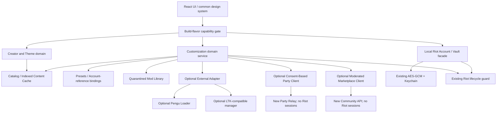

# System Architecture — One Platform, Three Local-First SKUs

## High-level logical graph



## Domain boundaries

- **`vault`** (only Local & Complete): privileged: session material. Owns save/load/launch. Never goes through generic file-export or HTTP services.
- **`customization`** (all SKUs): metadata and user-owned media, local presets, catalogue, mod file integrity and status. Only holds opaque `accountId` as optional local preference. No Riot tokens.
- **`adapter`** (Windows where supported, user-installed tool): install discovery, capabilities, health, compatibility, start/stop through public documented interfaces only. No hidden DLL, Tauri IPC hijack or kernel behaviors.
- **`client-theme`** (supported platform, consent): user-controlled scoped changes through separately installed approved loader/plugin; restore defaults transactionally.
- **`gameflow`** (optional consent): read-only lifecycle signals using supported local interface, with rate limit and privacy protection; not a general arbitrary LCU proxy.
- **`creator`**: open, validate, transform and export user-authored assets; no proprietary Riot bundle redistribution.
- **`community`**: remote catalog metadata and approved package downloads; no auth/session account data.
- **`party`**: optional short-lived room presence and content hash metadata; file transfers separately controlled, fully logged/consented and rights checked.
- **`commerce`**: signed entitlement claims and server-side order validation; does not contain game login/session credentials.
- **`updater`**: existing secure Tauri signing trust, separate SKU release identity.

## Module API design

All UI features call typed domain facades, not raw arbitrary Tauri invoke strings. Rust command types are serializable and validated. Invalid feature gates return `CapabilityUnavailable` with code + actionable human-readable explanation. The standalone Studio binary should not register vault IPC handlers, even if a devtools attacker calls a command manually.

Use one Rust `ServiceHub` containing `AppFlavor`, `CustomizationStore`, `TaskManager`, `CacheManager`, `RiotOperationCoordinator`, optional `AdapterManager`, optional network service clients and single-instance handler. Avoid global mutable state except narrowly scoped locks/events with ownership rules.

## Proposed source tree (see authoritative CSV for exact file list)

```
apps/desktop/src/features/customization/
  catalog/          # champion metadata, skin/chroma preview
  mods/             # local library, import/export, install status
  presets/          # per-account, per-champion, fallback rules
  themes/           # theme editor and preview
  gameflow/         # UI indicators and safe events
  party/            # peer list and explicit consents
  creator/          # inspector, validators, workstation
  marketplace/      # moderated remote catalog
  integrations/     # Discord, OP.GG, optional AI/TTS
  doctor/           # health/error/backup wizard
apps/desktop/src/product/ # compiled flavor capabilities
apps/desktop/src-tauri/src/customization/
  catalog.rs, store.rs, presets.rs, cache.rs, importer.rs, archive.rs,
  validator.rs, adapter.rs, gameflow.rs, tasks.rs, rights.rs, diagnostics.rs
apps/desktop/src-tauri/src/themes/
apps/desktop/src-tauri/src/party/
apps/desktop/src-tauri/src/commerce/
apps/desktop/src-tauri/src/creator/
apps/community-api/       # opt-in room/catalog/license only
apps/community-admin/     # optional moderation console
packages/customization-contracts/
packages/community-contracts/
```

## Rust vs Python decision

**Prefer Rust-only for runtime orchestration, file validation, cache index, profile binding, network client, subprocess management and safe shutdown.** Do not embed CPython 3.9 plus hundreds of megabytes of tooling merely because Wildflover does. For creator-only format conversion, choose a small, separate, licensed external CLI or optional helper when benchmarking proves necessity. No preinstalled helper should load into the League game process.

## Threading and concurrency

- Tokio async for network I/O; spawn blocking for disk/media decode and hashing. Never block Tauri main thread.
- `TaskManager` bounded worker pools by task type; max two large archive operations, max four thumbnail decodes; adjust after benchmarks.
- Content-addressed immutable cache; write/rename atomic commits; manifest schema version + checksum.
- Gameflow read-only collector debounced and phase-driven, not heavy 100ms polling across dozens of endpoints.
- Riot account launch / updater / theme apply / mod apply share an explicit lock ownership graph and transition journal. No lost cleanup on cancellation.

## Platform envelope

Windows 10/11 x64: primary target for actual mod patcher behavior, if allowed and supported. Windows arm64 browse-only unless tool validated. macOS x86_64/Apple Silicon: LAAP account management, catalog, creator and local themes where compatible; LTK Windows-only means no promise of functional Windows patcher on macOS. Test Pengu macOS separately. Never silently hide unsupported features or use disabled buttons without explanation.
