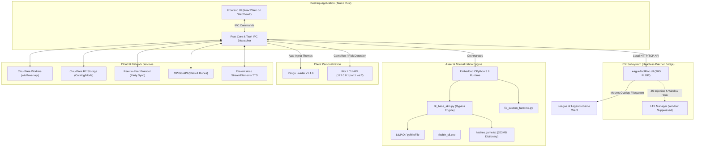

# Wildflover Technical Architecture & Reverse Engineering Analysis

Comprehensive technical analysis of **Wildflover** (version 4.0.7-x64), a third-party League of Legends skin management and client personalization suite. This documentation details its internal architecture, underlying open-source engines, headless patcher hijacks, asset manipulation pipelines, and cloud/P2P networking models discovered through static binary inspection.

---

## Architecture Blueprint

---

## Documentation Index

| File | Topic | Key Findings |
| :--- | :--- | :--- |
| **[`01-system-architecture.md`](./01-system-architecture.md)** | Core Structure & Tech Stack | Tauri/Rust foundation, NSIS installer, CS-LoL to LTK migration timeline |
| **[`02-ltk-patcher-and-bridge.md`](./02-ltk-patcher-and-bridge.md)** | Headless Patcher Hijack | `LeagueToolFlop.dll`, window suppression, WebView injection, local TCP/HTTP server |
| **[`03-skin-normalization-bypass.md`](./03-skin-normalization-bypass.md)** | LTK Anti-Skinhack Bypass | `ltk_base_skin.py`, Identity Borrowing, Mesh Repointing (`_nmx` extension + padding) |
| **[`04-mod-tooling-and-skinlab.md`](./04-mod-tooling-and-skinlab.md)** | Modding Pipeline & SkinLab | Embedded LtMAO, `pyRitoFile`, `ritobin`, `fix_custom_fantome.py`, SkinLab commands |
| **[`05-client-themes-pengu-lcu.md`](./05-client-themes-pengu-lcu.md)** | Client UI Themes & LCU | Pengu Loader integration, CSS/audio/font injection, LCU gameflow automation |
| **[`06-networking-p2p-and-cloud.md`](./06-networking-p2p-and-cloud.md)** | Networking, P2P & Cloud | Cloudflare Workers/R2 catalog, custom P2P chunk transfer, Discord RPC, OP.GG |
| **[`07-tauri-ipc-commands-reference.md`](./07-tauri-ipc-commands-reference.md)** | IPC Command Reference | Exhaustive catalog of ~80 Tauri IPC command handlers extracted from binary |
