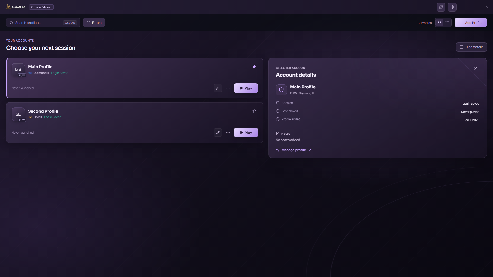

<div align="center">
  
  <h1>LAAP Desktop</h1>
  <p><strong>The modern, secure account manager and stealth presence launcher for League of Legends.</strong></p>

  <p>
    <a href="https://github.com/Kingof3O/laap/releases/latest"></a>
    <a href="https://github.com/Kingof3O/laap/actions"></a>
    <a href="LICENSE"></a>
    
    
  </p>

  <p>
    <a href="https://github.com/Kingof3O/laap/releases/latest"><strong>⬇️ Download Latest Release</strong></a> •
    <a href="#key-features">Key Features</a> •
    <a href="#how-it-works">How It Works</a> •
    <a href="#choose-your-edition">Editions</a> •
    <a href="#security--anti-cheat-safety">Security & Safety</a> •
    <a href="#local-development">Development</a>
  </p>
</div>

---

## Overview

**LAAP** (League Account Auto Provisioner) is a native, high-performance desktop launcher engineered for League of Legends players who manage multiple accounts. Built on **Tauri 2**, **Rust**, and **React 19**, LAAP eliminates the friction of logging into smurfs, scrim accounts, and alts—allowing you to switch profiles in a single click without re-entering passwords or solving 2FA challenges every time.

Featuring a dark-first, refined **Velvet Amethyst** aesthetic, LAAP delivers the responsiveness and polish of a premier native desktop utility while keeping your credentials cryptographically secured in your hardware vault.

---

## Desktop Showcase



*Organized roster with instant launch actions, live competitive rank crests, custom notes, and a retractable profile inspector.*

---

## Key Features

### ⚡ 1-Click Fast Account Switching
Switch seamlessly between your main, smurfs, and alternate accounts in seconds. LAAP securely restores your active Riot Client session handshakes, launches the official client directly into League of Legends, and updates your last-played history without touching game memory.

### 🛡️ 100% Anti-Cheat Safe (Zero Ban Risk)
LAAP operates strictly external to game processes. It performs **no DLL injection, no game memory inspection, no asset modification, and no gameplay automation**. It interfaces exclusively with official Riot Client configuration mechanisms, making it fully compliant with Riot Games Terms of Service and Vanguard protections.

### 🔒 Military-Grade Encrypted Vault
Your session material is protected with **AES-256-GCM** authenticated encryption. Encryption keys are generated randomly and stored directly in your operating system's secure credential store (**Windows Credential Manager** or **macOS Keychain**). Your Riot passwords are never stored in plaintext on disk or transmitted across networks.

### 👻 Stealth LAAP Presence
Play games in complete stealth. LAAP includes an integrated local proxy that lets you appear **Offline** or set custom presence states in League chat while actively queuing and playing games with friends. Easily toggled from the top header or your system tray.

### 📝 Smurf Notes, Favorites & Custom Profiles
- **Profile Notes:** Add context to your accounts (e.g., *"Duo with Alex"*, *"Mid practice smurf"*, *"D1 MMR"*).
- **Favorites & Recency:** Star your daily accounts to keep them pinned at the top, with dynamic recency indicators showing where you last played.
- **Ranks & Crests:** Automatic Solo/Duo rank synchronization and custom summoner icon caching directly from Data Dragon.
- **Quick Search (`Ctrl+K` / `Cmd+K`):** Instantly filter accounts by summoner name, server region, or competitive tier.

### 🪟 Windows Frameless Title Bar & System Tray
Enjoy a native, borderless desktop window with drag support, maximize/restore toggling, and close-to-tray capability. Quick-switch accounts or change presence directly from your Windows Notification Tray or macOS Menu Bar.

---

## Choose Your Edition

LAAP is distributed in two editions tailored to your workflow:

| Feature | LAAP Offline (Community) | LAAP Team Edition |
| :--- | :---: | :---: |
| **Personal Account Roster** | ✅ Included | ✅ Included |
| **1-Click Launch & Safe Switch** | ✅ Included | ✅ Included |
| **AES-256-GCM Local Vault** | ✅ Included | ✅ Included |
| **Stealth LAAP Presence** | ✅ Included | ✅ Included |
| **Profile Notes, Ranks & Avatars** | ✅ Included | ✅ Included |
| **Zero-Network Privacy Sandbox** | ✅ Strict (`connect-src 'none'`) | Standard |
| **In-App Update Verification** | ✅ Native Host (Zero Telemetry) | ✅ Automatic / Native |
| **Shared Accounts & Team Leases** | ❌ None (100% Offline) | ✅ Multi-user Team Pool |
| **Team Role-Based Access Control** | ❌ None | ✅ Admin / Member Roles |

- **LAAP Offline**: Designed for solo players and privacy purists. All cloud networking is stripped at compile-time, and the webview enforces a strict zero-connection Content Security Policy.
- **LAAP Team Edition**: Built for esports organizations, collegiate teams, and communities that share accounts with atomic concurrency leasing.

---

## Security & Anti-Cheat Safety

LAAP was engineered from day one with a strict security boundary:

1. **No Password Ingestion:** LAAP does not prompt for or harvest Riot account passwords. Instead, you log in normally through the official Riot Client once; LAAP captures the local session token created by Riot.
2. **Match Protection Guard:** Before switching accounts or shutting down Riot processes, LAAP scans active process trees. If a live League of Legends or Valorant match is in progress, LAAP blocks termination and demands explicit user confirmation to prevent accidental remakes or AFK penalties.
3. **Hardware Keystore Binding:** Stored tokens are bound to your local OS user account via Windows DPAPI / Keychain. Exporting or moving vault files to another computer cannot decrypt your sessions.
4. **Transparent Native Code:** The complete native backend is open-source and audited in Rust. See our [Security Model](docs/SECURITY_MODEL.md) and [Native Interaction Verification](docs/ANTI_BAN_VERIFICATION.md).

---

## Installation & Downloads

Pre-built binaries are available for Windows and macOS on our [Releases Page](https://github.com/Kingof3O/laap/releases/latest):

### Windows
- **NSIS Installer (`.exe`)**: Recommended. Installs to standard user local application directories without requiring Administrator UAC elevation.
- **Windows Installer (`.msi`)**: Enterprise-ready installer package.

### macOS
- **Universal DMG (`.dmg`)**: Native universal bundle supporting both Apple Silicon (M1/M2/M3/M4) and Intel Macs.

---

## Local Development

Prerequisites: Node.js 22+, Rust (stable), and Microsoft C++ Build Tools (on Windows).

```bash
# Clone the repository
git clone https://github.com/Kingof3O/laap.git
cd laap

# Install dependencies
npm ci

# Run Team Edition (Native Desktop)
npm --workspace @laap/desktop run tauri dev

# Run Offline Edition (Native Desktop)
npm --workspace @laap/desktop run tauri:offline

# Quick Browser UI Preview (Vite)
npm --workspace @laap/desktop run dev
npm --workspace @laap/desktop run dev:offline
```

### Verification & Testing
```bash
# Run deterministic updater, sorting, and lease test suites
npm --workspace @laap/desktop run test:updater
npm --workspace @laap/desktop run test:sorting
npm --workspace @laap/desktop run test:lease-exit

# Run full Playwright UI integration suite (19 tests)
npm --workspace @laap/desktop run test:ui

# Run native Rust unit test suite (48 tests)
npm --workspace @laap/desktop run test
```

---

## License & Attribution

- **License:** MIT License. See [LICENSE](LICENSE) for details.
- **Disclaimer:** LAAP is an independent open-source tool and is not endorsed by, affiliated with, or associated with Riot Games, Inc. League of Legends and Riot Games are trademarks or registered trademarks of Riot Games, Inc.
- **Version History & Changelog:** For technical release notes and patch history, consult [CHANGELOG.md](CHANGELOG.md) and the [V2 Implementation Reports](docs/LAAP_V2_IMPLEMENTATION_REPORT.md).
