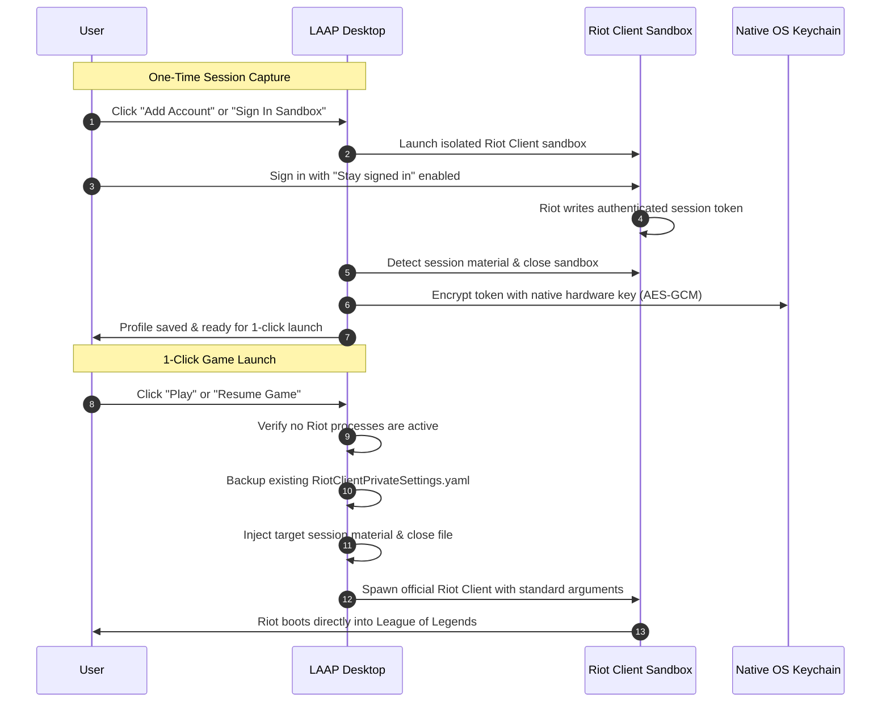

<div align="center">


<br />

# LAAP
### The High-Performance, Vanguard-Safe Account Launcher for League of Legends

**Switch accounts in one click. Zero passwords handled. 100% Vanguard clean.**

[](https://github.com/Kingof3O/laap/releases/latest)
[](https://github.com/Kingof3O/laap/actions)
[](docs/ARCHITECTURE.md)
[](https://tauri.app/)
[](https://www.rust-lang.org/)
[](docs/ANTI_BAN_VERIFICATION.md)
[](LICENSE)

<br />

[**⬇️ Download for Windows (.exe)**](https://github.com/Kingof3O/laap/releases/latest) &nbsp;&bull;&nbsp; [**⬇️ Download for macOS (.dmg)**](https://github.com/Kingof3O/laap/releases/latest)

<br />

[Architecture](docs/ARCHITECTURE.md) &bull; [Anti-Cheat Safety](docs/ANTI_BAN_VERIFICATION.md) &bull; [Security Model](docs/SECURITY_MODEL.md) &bull; [Profile Customization](docs/profile-customization.md) &bull; [Development Guide](docs/DEVELOPMENT.md) &bull; [Production Guide](docs/PRODUCTION.md)

</div>

---

## ⚡ Overview & Product Philosophy

Switching between your mains, smurfs, and scrim accounts in League of Legends has always been slow, clunky, and frustrating—manually re-typing credentials, solving 2FA prompts, and waiting through tedious Riot Client restarts.

**LAAP** solves this permanently. Built with **Tauri v2** and **Rust**, LAAP is a lightweight, esports-grade account access launcher that boots directly into League of Legends with zero friction. It functions as an external configuration manager that boots the official Riot Client with your authenticated session, completely eliminating password handling, keystroke injection, and memory hooks.

```
Pick Account ➔ Click Play ➔ Official Riot Client boots ➔ Jump on the Rift
```

> **Simple, Fast, and Clean:**  
> LAAP is an operator tool designed for players and competitive rosters. It exposes only what you need to jump straight into the Rift. Zero Riot passwords handled, zero keystroke injection, and zero memory hooks.

---

## 📸 Interface Preview & Visual Tour

### 🎮 Personal Roster & Hero Quick-Resume
Your most recently played summoner is prominently featured at the top of the roster. Review your last-played timestamp (`Played 2h ago`), official rank tier crest, and jump straight back into queue with a single click. The full-width responsive grid organizes your roster across 3–4 columns with Hextech Sapphire styling.

<div align="center">
  
</div>

<br />

### ✨ Add & Edit Profile Customizer
A live two-column editor with instant preview. Choose a local photo or pick from a searchable catalog of official League icons, select a server region, assign your competitive rank tier, and write private notes in your local encrypted vault.

<div align="center">
  
</div>

<br />

### 📊 High-Density List View
Prefer compact information? Toggle instantly to the high-density table view with sortable columns, server badges, and quick context actions.

<div align="center">
  
</div>

<br />

### 🌐 Shared Accounts Pool (Team Edition)
Access shared team accounts with atomic single-active session locking, hardware signature verification, and instant release mechanics. Prevents concurrent collision conflicts during scrims or tournaments.

<div align="center">
  
</div>

---

## ⚔️ Why LAAP? (Comparison Matrix)

| Feature / Guarantee | Traditional Account Launchers | Browser Password Managers | LAAP Platform |
|:---|:---:|:---:|:---:|
| **Password Storage** | Plaintext / Weak AES on disk | Encrypted vault (requires master pass) | **Zero Passwords Handled** (Session-based) |
| **Runtime Behavior** | ⚠️ Keystrokes / memory hooks | N/A | **Zero Memory or Code Injection** (Vanguard Safe) |
| **1-Click Game Launch** | ❌ (Prompts for 2FA / CAPTCHA) | ❌ (Manual copy-paste) | **Instant** (Direct authenticated boot) |
| **Multi-Region Organization** | ❌ Flat list | ❌ Flat list | **Built-in Filters** (`KR`, `EUW`, `NA`, `EUNE`, `BR`) |
| **Hardware Binding** | ❌ None | ❌ None | **Ed25519 OS Keychain Keypair** |
| **Shared Account Protection** | ⚠️ Concurrent collision conflicts | ⚠️ Password leaks & desyncs | **Atomic Single-Active Lease Locking** |
| **In-App Release Updates** | ❌ Manual browser checks | N/A | **Automatic GitHub Releases Modal** |

---

## 🌟 Core Features in Depth

### 1. 👑 Hero Quick-Resume Strip
- **Automatic Most-Recent Detection**: Inspects timestamps in your encrypted local store and automatically surfaces the last account you played.
- **Dynamic Selection Preview**: Click any card in your roster to dynamically shift the Hero Strip to that profile for instant 1-click launch or profile editing.
- **Relative Time Tracking**: Real-time relative activity badges (`Played 2h ago`, `Played yesterday`).
- **Official Rank Crests**: Features authentic colored badges for **Challenger**, **Grandmaster**, **Master**, **Diamond**, **Emerald**, **Platinum**, **Gold**, **Silver**, **Bronze**, and **Iron**.

### 2. 🌐 Multi-Region Roster & Organization
- **Instant Search (`⌘K` / `Ctrl+K`)**: Rapidly search across summoner names, server regions, and custom notes.
- **Region Grouping**: 1-click filter pills for `EUW`, `NA`, `KR`, `EUNE`, `BR`, `LAN`, `LAS`, `OCE`, `TR`, `RU`, and `ME`.
- **Multi-Criteria Sorting**: Sort by competitive tier (highest/lowest first), summoner name (A–Z / Z–A), last played, or date added.
- **Dual Layout Switcher**: Seamlessly switch between the **Full Responsive Grid** and the **High-Density Table**.

### 3. 🎨 Rich Profile Customization
- **Searchable Icon Catalog**: Browse and search official Riot Data Dragon profile icons directly inside the app.
- **Custom Image Upload**: Upload local PNG, JPEG, or WebP images (up to 5 MB); native code normalizes, crops, and removes metadata for local privacy.
- **Rank Emblems**: All 10 competitive emblems and unranked crests are bundled locally—no internet required.
- **Optional League Client Sync**: Opt-in to periodically sync your active summoner icon and Solo/Duo rank directly from the local League Client lockfile over loopback (`127.0.0.1`).

### 4. 🛡️ Match In-Progress Guard
- **Active Process Detection**: Inspects native system processes for `League of Legends.exe` before any account switch.
- **Confirmation Protection**: Prompts with a protective dialog if a match is actively in progress, preventing accidental disconnects or queue penalties.

---

## 🛡️ Anti-Cheat & Vanguard Safety Proofs

LAAP is engineered to operate strictly as an **external pre-launch configuration manager**. It never interacts with League of Legends while the game is running:

- **Zero Memory Injection**: Never invokes `WriteProcessMemory`, `VirtualAllocEx`, `CreateRemoteThread`, or attaches debuggers to League or Riot processes.
- **Zero DLL or Code Hooks**: Does not hook DirectX/Direct3D graphics pipelines, inject DLLs, or manipulate operating system window hooks.
- **Bit-for-Bit Identical Files**: Game binaries, archives (`.wad`), and official files remain bit-for-bit identical.
- **Clean Dormant Lifecycle**: Session YAML files are written **only when Riot processes are completely offline**. File descriptors are closed immediately before launching.
- **Official Client Execution**: Spawns the authentic Riot Client binary using verified standard arguments:
  ```rust
  pub const LEAGUE_LAUNCH_ARGS: [&str; 2] = [
      "--launch-product=league_of_legends",
      "--launch-patchline=live",
  ];
  ```
- **No In-Game Advantage**: Zero macros, zero overlays, zero timers, and zero input automation.

👉 **Inspect the complete source code proofs in our [Anti-Cheat Verification Guide](docs/ANTI_BAN_VERIFICATION.md).**

---

## 📦 Two Release Editions

| Feature / Capability | **LAAP Offline** *(Community Edition)* | **LAAP Desktop** *(Team Edition)* |
|:---|:---:|:---:|
| **Primary Use Case** | Solo players, smurfs, streamers | Competitive teams, scrim rosters, friend groups |
| **Personal Roster** | Unlimited local profiles | Unlimited local profiles |
| **Shared Team Vault** | &mdash; | Cloud account pool with atomic lease locking |
| **Network Footprint** | **100% Offline** (Zero telemetry, zero API calls) | Private authenticated team API via JWT |
| **Hardware Binding** | Local OS Keychain keypair | Ed25519 challenge-response verification |
| **Webview CSP** | `connect-src 'none'` | Authenticated team backend endpoints |
| **Download Artifacts** | `.exe` (Windows) &bull; `.dmg` (macOS) | `.exe` (Windows) &bull; `.dmg` (macOS) |

---

## 🔐 Deep Technical Architecture

### 1. Passwordless Session Sandboxing Flow

LAAP never prompts for, accepts, or stores Riot account passwords. Instead, it operates strictly at the authenticated session layer:



### 2. Ed25519 Hardware Device Authentication
- Every physical installation generates a unique **Ed25519 cryptographic keypair** stored in the native OS keychain (**macOS Keychain** / **Windows Credential Manager**).
- When claiming a shared account lease in Team Edition, the client signs a time-bound cryptographic server challenge (`${timestamp}:${accountId}`).
- Replay attacks, spoofed requests, and unauthorized devices are rejected at the edge.

### 3. Atomic Single-Active Concurrency Control (Team Vault)
- Lease acquisitions execute inside serialized PostgreSQL transactions (`acquireLease`).
- A partial unique index (`WHERE status IN ('starting', 'active', 'stopping')`) strictly guarantees that **no account can ever be leased by more than one player concurrently**.
- Automatic heartbeat monitoring reclaims abandoned sessions if a player disconnects unexpectedly.

---

## 🖥️ Full Cross-Platform Parity (Windows & macOS)

| Subsystem | Windows (10 & 11 64-bit) | macOS (Apple Silicon & Intel) |
|:---|:---|:---|
| **Installation** | Single-user NSIS (`%LOCALAPPDATA%\Programs\LAAP`) &mdash; **Zero UAC prompt** | Native drag-and-drop Apple Disk Image (`.dmg`) & App Bundle |
| **Hardware Key Storage** | Windows Credential Manager (`windows-native`) | Apple Keychain (`apple-native`) |
| **Riot Data Directory** | `%LOCALAPPDATA%\Riot Games\Riot Client\Data` | `~/Library/Application Support/Riot Games/Riot Client/Data` |
| **Local Store Directory** | `%APPDATA%\LAAP\` | `~/Library/Application Support/LAAP/` |
| **Process Control** | Direct dispatch to `RiotClientServices.exe` | Native dispatch via `/Applications/Riot Client.app` |
| **Process Inspection** | Win32 sysinfo PID & handle polling | Darwin sysinfo PID & process inspection |
| **Tactical Hotkeys** | `Ctrl+K` (Search), `Esc`, `Tab`, `Enter` | `⌘K` (Search), `Esc`, `Tab`, `Enter` |

---

## ⌨️ Tactical Hotkeys

| Shortcut | Action | Scope |
|:---|:---|:---|
| **`⌘K` / `Ctrl+K`** | Focus instant summoner search bar | Global |
| **`Esc`** | Clear search filter or dismiss open modal | Global |
| **`Tab`** | Cycle through summoner cards and action buttons | Roster Stage |
| **`Enter` / `Space`** | Launch game on focused summoner profile | Focused Card |

---

## 🏛️ System Monorepo Structure

```text
┌────────────────────────────────────────┐       ┌──────────────────────────────────────┐
│       LAAP Desktop Launcher            │       │       Web Control Center             │
│   (Tauri v2 + Rust + React 19)         │       │     (React 19 + Tailwind CSS)        │
└──────────────────┬─────────────────────┘       └──────────────────┬───────────────────┘
                   │                                                │
                   │ typed DTOs & Zod contracts                     │ typed DTOs
                   ▼                                                ▼
┌───────────────────────────────────────────────────────────────────────────────────────┐
│                    Shared Packages (@laap/types, @laap/validation)                     │
└──────────────────────────────────────────┬────────────────────────────────────────────┘
                                           │ authenticated HTTP / Ed25519 signatures
                                           ▼
┌───────────────────────────────────────────────────────────────────────────────────────┐
│              LAAP Core API (Cloudflare Worker / Node HTTP)                            │
│               - Domain Services: IAuth, IAccount, ILease, IDevice, IAdmin             │
│               - Atomic lease acquisition functions & access control                   │
└──────────────────────────────────────────┬────────────────────────────────────────────┘
                                           │
                                           ▼
┌───────────────────────────────────────────────────────────────────────────────────────┐
│            Supabase Cloud Infrastructure (PostgreSQL, Vault, RLS)                     │
│               - Atomic single-active lease enforcement via Postgres RPC               │
│               - Encrypted session store with Row Level Security                       │
└───────────────────────────────────────────────────────────────────────────────────────┘
```

Detailed architectural diagrams and domain breakdowns are available in [docs/ARCHITECTURE.md](docs/ARCHITECTURE.md).

---

## 🚀 Development & Build Guide

### Prerequisites
- **Node.js**: `v22.0.0` or higher
- **Rust Toolchain**: `stable` (MSRV 1.80+) with `cargo`
- **macOS Requirements**: Xcode Command Line Tools (`xcode-select --install`)
- **Windows Requirements**: Visual Studio Build Tools (C++ Desktop Development) and WebView2 Runtime

### Setup & Local Development
```bash
# 1. Clone repository
git clone https://github.com/Kingof3O/laap.git
cd laap

# 2. Install dependencies across all workspaces
npm install

# 3. Start local development (API & Admin web portal)
npm run dev

# 4. Start native desktop app with Vite HMR
npm --workspace @laap/desktop run dev
```

### Building Native Desktop Releases

#### 1. LAAP Desktop (Team Edition)
```bash
# On macOS (generates LAAP Desktop.dmg & .app)
npm --workspace @laap/desktop run build
npx --workspace @laap/desktop tauri build --bundles app,dmg

# On Windows (generates LAAP-Setup.exe & .msi)
npm --workspace @laap/desktop run build
npx --workspace @laap/desktop tauri build --bundles msi,nsis
```

#### 2. LAAP Offline (Community Edition)
```bash
# On macOS (generates LAAP Offline.dmg & .app)
npm --workspace @laap/desktop run build:offline
npx --workspace @laap/desktop tauri build --config src-tauri/tauri.offline.conf.json --bundles app,dmg

# On Windows (generates LAAP-Offline-Setup.exe & .msi)
npm --workspace @laap/desktop run build:offline
npx --workspace @laap/desktop tauri build --config src-tauri/tauri.offline.conf.json --bundles msi,nsis
```

### Running Test Suites
```bash
# Run unit and integration tests across monorepo
npm run test

# Run native Rust desktop safety tests
cargo test --manifest-path apps/desktop/src-tauri/Cargo.toml
```

---

## 📜 License

Distributed under the [MIT License](LICENSE).
