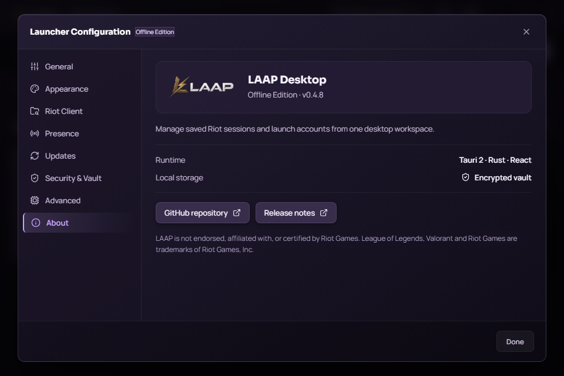

<h1></h1>

<strong>LAAP V2 — Premium desktop roster, tactical launcher, and account manager for League of Legends.</strong>

<a href="https://github.com/Kingof3O/laap/releases/latest"><strong>Download for Windows or macOS</strong></a>

  
  
  

LAAP V2 transforms account management into a refined, native desktop experience. Built with Tauri v2, Rust, and React 19, LAAP organizes saved Riot Client sessions into an encrypted personal roster, providing instant account switching, custom summoner styling, and stealth LAAP Presence. It includes both a zero-leak Offline Edition and an optional Team Edition with cloud leases.

Windows installers are currently unsigned while the SignPath Foundation application awaits review. Windows may display Microsoft Defender SmartScreen's unknown-publisher warning. See the [code-signing policy](CODE_SIGNING.md) and [privacy policy](PRIVACY.md).

## Desktop preview

These previews use test profiles and simulated application state. More captures and verification details are available in the [V2.3 report](docs/LAAP_V2_3_FINAL_REPORT.md).

## What's New in LAAP V2.3

- **Velvet Amethyst design:** Layered violet surfaces, lavender actions, locally bundled typography, and an atmospheric desktop background.
- **Optional profile details:** Show or hide a persistent inspector with the selected account's saved information.
- **Contextual presence:** Requested and applied presence states are shown in the header, with the guarded restart action available when needed.
- **Quieter profile sync:** Routine background checks avoid repeatedly displaying a foreground syncing state.
- **Responsive roster:** Manage profiles in a grid or compact table, with favorites and recent-account indicators.
- **Custom Native Titlebar:** Windows frameless title bar with native window dragging, maximize/restore, minimize, and seamless integration with the close-to-tray lifecycle.
- **Contextual Context Menus:** Replaced cluttered multi-button card layouts with a clean primary launch action and an accessible context menu for secondary operations.
- **Two-Column Settings Workspace:** Spacious 900px configuration modal organized into modular categories (General, Appearance, Riot Client, Presence, Updates, Security & Storage, Advanced, About).
- **Edition-Aware Update System:** Native update checking powered by Rust host requests that respect the Offline Edition's `connect-src 'none'` Content Security Policy with zero telemetry.
- **Single-Instance Protection:** Prevents duplicate running instances or multiple system tray icons.

## Features

- **Personal roster:** Save account profiles with names, regions, rank, notes, favorites, and locally cached icons.
- **Find and organize:** Search with `Ctrl+K` / `Cmd+K`, filter by region or competitive rank, and sort by name, rank, last played, or date added.
- **Switch and stop safely:** Launch a saved session or close Riot and League processes while preserving saved logins. LAAP checks for an active game before stopping or switching.
- **Keep profile details current:** Sign in again to refresh an expired session without replacing its profile details. Optional icon and Solo/Duo rank synchronization is available with separate opt-ins.
- **LAAP Presence:** Set the default game presence at startup and control it from the Windows tray or macOS menu bar. The system menu also offers saved local profiles.
- **Two editions:** Choose the local Offline edition or the Team edition with shared accounts and administration.

## Editions

| Capability | LAAP Offline | LAAP Desktop (Team) |
| --- | --- | --- |
| Personal roster, profile notes, favorites, and sorting | Included | Included |
| Local image uploads and bundled rank crests | Included | Included |
| Riot icon downloads and League Client sync | Optional, user-controlled | Optional, user-controlled |
| Shared Accounts and administration | Not included | Private team service |
| In-app update check (Native GitHub endpoint) | Manual/native only (Zero telemetry) | Automatic on startup & manual |
| Cloud API and remote sync | Disabled (`connect-src 'none'`) | Team features and cloud leases |
| Windows downloads | EXE (NSIS) and MSI | EXE (NSIS) and MSI |
| macOS downloads | Universal DMG and app archive | Universal DMG and app archive |

Offline describes the edition's app services: it makes no cloud API requests. Its webview enforces `connect-src 'none'`. Update verification queries only the public GitHub Releases API via a native Rust client that transmits no user data or identifiers.

## Security and platform boundaries

LAAP does not ask for or store Riot passwords. It captures session material produced by the official Riot Client. Session blobs are encrypted with AES-256-GCM using a key held in the operating system keychain. Profile details such as names, regions, ranks, notes, and favorites are stored locally as readable metadata.

Optional League Client sync uses authenticated, read-only requests to the local client. Presence uses local proxy services to route selected Riot traffic. Offline builds disable cloud authentication and enforce strict Content Security Policies in the webview.

LAAP is an unofficial Riot client integration. It does not inject code, inspect game memory, or automate gameplay. See the [security model](docs/SECURITY_MODEL.md), [native interaction notes](docs/ANTI_BAN_VERIFICATION.md), and [V2 Implementation Report](docs/LAAP_V2_IMPLEMENTATION_REPORT.md).
