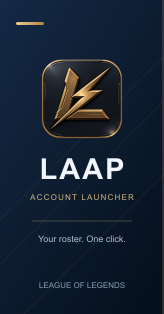
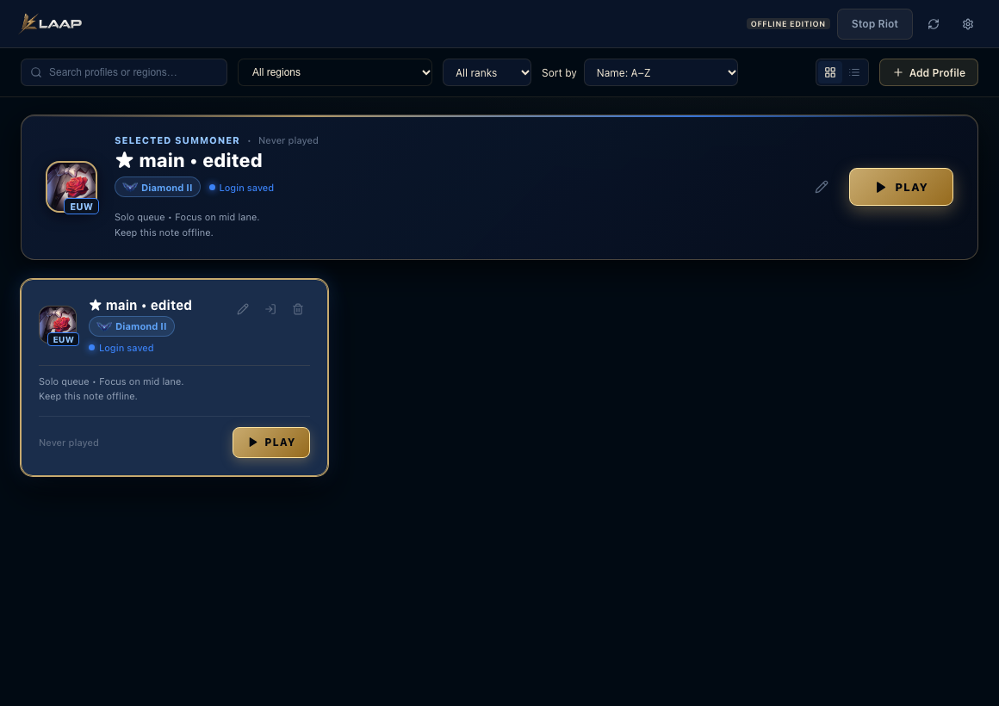
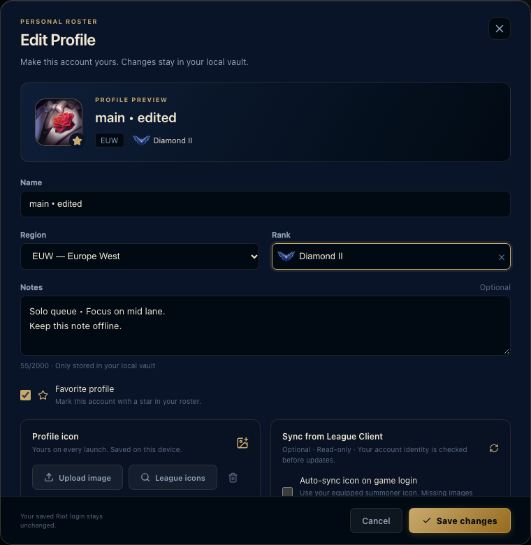
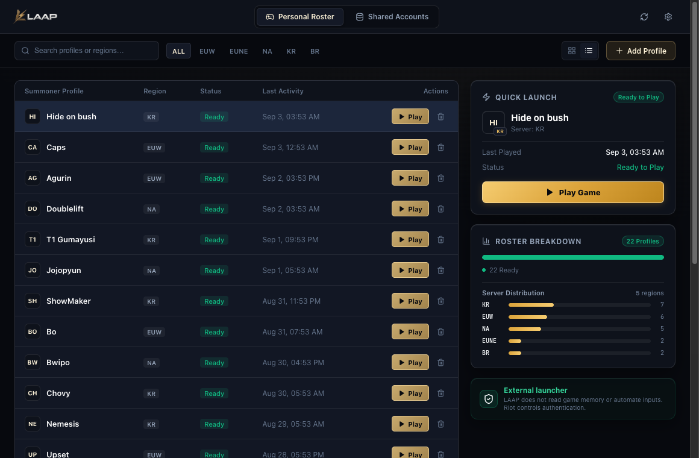
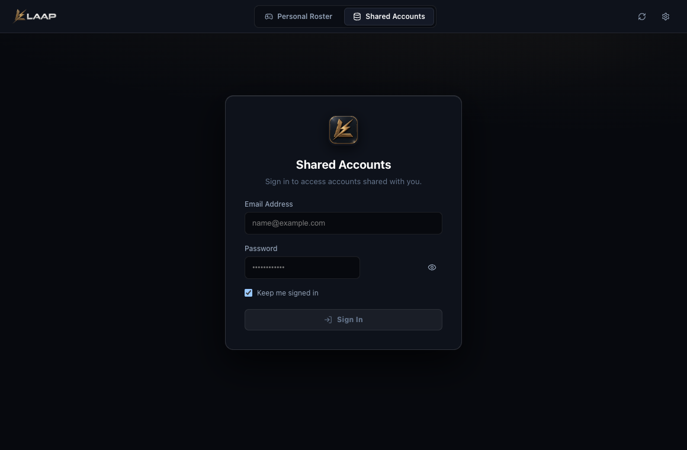
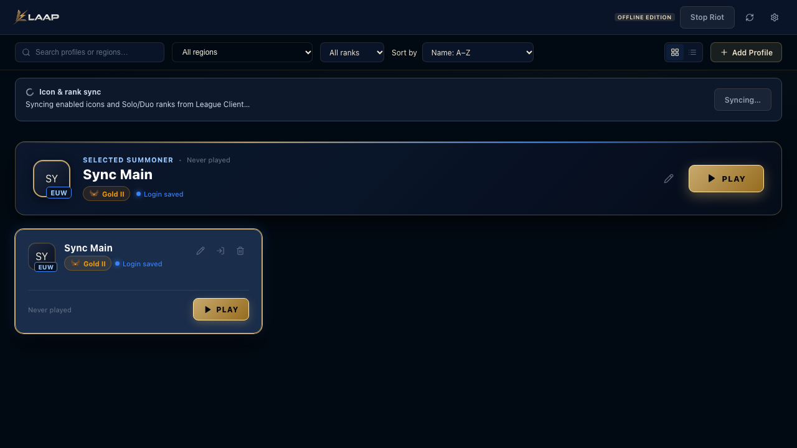
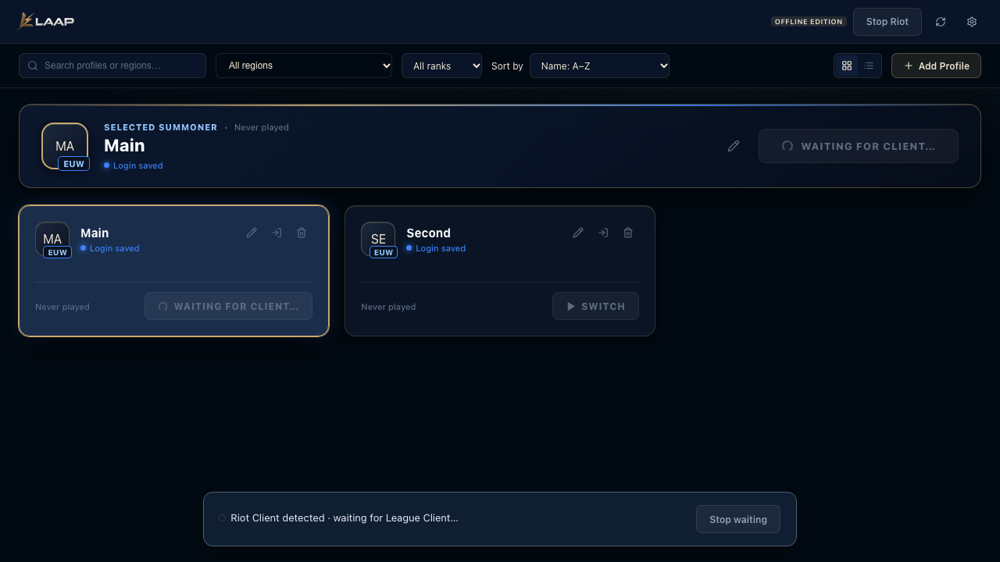

<div align="center">


# LAAP

**A local account roster and desktop launcher for League of Legends.**

[](https://github.com/Kingof3O/laap/releases/latest)
[](https://github.com/Kingof3O/laap/actions)
[](LICENSE)

[Download for Windows and macOS](https://github.com/Kingof3O/laap/releases/latest)

[Code signing policy](CODE_SIGNING.md) · [Privacy policy](PRIVACY.md)

Windows releases are currently unsigned. LAAP is preparing its SignPath Foundation application; acceptance and signing access are pending.

The Windows installer sidebar uses the same current LAAP artwork as the desktop icon:



[Profile customization](docs/profile-customization.md) · [Development](docs/DEVELOPMENT.md) · [Architecture](docs/ARCHITECTURE.md) · [Security](docs/SECURITY_MODEL.md) · [API](docs/API.md) · [Deployment](docs/PRODUCTION.md)

</div>

## v0.4.5: visible sync and startup feedback

Icon/rank sync now shows pending, success, waiting, and failure states with **Sync now / Retry sync**, plus timestamps. Icon previews have loading indicators and retries. Account switching tracks Riot/League startup, prevents repeated launches, and explains timeouts. Progress uses actual status text and spinners, without invented percentages. The v0.4.4 shutdown-race fix remains included. The Windows setup sidebar has been regenerated from its upright SVG artwork.

## v0.4.6: Riot discovery and LAAP Presence

Riot installations on custom Windows drives are discovered through installation records, process metadata and registry lookup, with a saved path override. v0.4.6 includes Windows LAAP Presence. Current source also adds automatic presence setup with a saved Online/Offline startup choice, macOS presence, and system-bar controls for presence and saved local accounts; a new release is required for those additions. See the [setup, privacy and validation notes](docs/riot-installation-and-presence.md).

## What LAAP does

Save a Riot Client login through the official client, organize your profiles, and launch a selected account. LAAP stores session material rather than asking for Riot passwords. Saved logins can expire or be revoked; **Sign in again** refreshes the existing profile while keeping its name, region, rank, notes, and favorite status.

The current session capture/injection integration is unofficial. LAAP does not inject code, inspect game memory, or automate gameplay; those implementation facts do not establish Riot approval or a ban guarantee. See [native interaction details](docs/ANTI_BAN_VERIFICATION.md).

## Current interface

These screenshots show the v0.4.3 interface, captured on 2026-10-14. Roster/editor images use a test profile through a test-only IPC fixture. The Shared Accounts image shows the signed-out screen; production builds contain no fabricated roster.

### Personal Roster

Your selected profile shows its avatar, region, rank, saved notes, and login status. The initial selection prefers the most recently played profile when available. **Play** switches to that profile; **Stop Riot** closes the clients while preserving saved logins. Either action requests confirmation if a League or Valorant game process is detected.



### Add and edit profiles

The editor previews the name, avatar, region, and rank as you edit. Regions are grouped geographically; ranks include Unranked, Iron–Diamond IV–I, and the three apex tiers. Upload a local image or explicitly download League profile icons. Images are cached on the device; rank crests are bundled.



### Compact list

Grid and list views share search, grouped region filtering, rank filtering, and a **Sort by** dropdown. Sort by name, competitive rank, last played, or date added. Unranked and unrecognized ranks stay last in either rank direction. Notes and avatars are visible in both layouts.



### Shared Accounts sign-in — Team Edition

Team Edition includes a separate LAAP sign-in screen for shared accounts. Operators see assigned accounts; administrators manage the pool. Shared launches use server leases to prevent concurrent claims.



### Sync and startup status

Retry enabled icon/rank sync without changing your saved opt-ins. While Riot opens, the launch button stays busy and the status bar reports which client has been detected. **Stop waiting** ends observation without closing the client.





## Editions

| Capability                                          | LAAP Offline                                     | LAAP Desktop (Team)                              |
| :-------------------------------------------------- | :----------------------------------------------- | :----------------------------------------------- |
| Personal Roster, notes, favorites, sorting          | Yes                                              | Yes                                              |
| Local image uploads and bundled rank crests         | Yes                                              | Yes                                              |
| Optional Riot icon downloads and League Client sync | Yes, explicit opt-in                             | Yes, explicit opt-in                             |
| Shared Accounts and LAAP authentication             | Disabled                                         | Private team API                                 |
| GitHub update polling                               | Disabled; static Offline Edition badge           | Automatic and manual checks                      |
| Downloads                                           | Windows EXE/MSI; universal macOS DMG/app archive | Windows EXE/MSI; universal macOS DMG/app archive |

Offline Edition makes no cloud API or update requests. Its webview uses `connect-src 'none'`; optional native commands can download Data Dragon icons and contact the local League Client when enabled. Uploaded images remain local. **Auto-sync icon** and **Auto-sync rank** are independent and off by default; rank sync reads Solo/Duo and requires a matching saved PUUID. See [caching and sync behavior](docs/profile-customization.md).

## Storage and reliability

- Native JSON vault with AES-256-GCM encrypted session blobs and an OS-keychain vault key. Profile metadata and cached images are local files, not encrypted by that session envelope.
- Serialized read/modify/write operations, unique temporary files, atomic replacement, and quarantine of unreadable account records.
- Reviewed imports, owned provisioning cancellation, and recovery of interrupted session backups.
- Loading, error, and retry states; no demo accounts if the native IPC bridge is unavailable.
- Escape, focus trapping, and focus restoration in dialogs; `⌘K` / `Ctrl+K` focuses search.

## Development

Use Node.js 22+, the current stable Rust toolchain, and platform build tools. From the repository root:

```sh
npm ci
npm run dev                         # API and admin web UI
npx --workspace @laap/desktop tauri dev  # Native desktop window + Vite
```

`npm --workspace @laap/desktop run dev` starts only Vite. For an Offline native development window, see [the development guide](docs/DEVELOPMENT.md).

```sh
npm run test
npm run typecheck
npm run build
npm --workspace @laap/desktop run build:offline
npm --workspace @laap/desktop run test:sorting
npx playwright install chromium
npm --workspace @laap/desktop run test:ui
cargo check --locked --manifest-path apps/desktop/src-tauri/Cargo.toml
cargo test --locked --manifest-path apps/desktop/src-tauri/Cargo.toml
```

The [v0.4.3 release](https://github.com/Kingof3O/laap/releases/tag/v0.4.3) passed GitHub tests, security scans, and all four installer builds. Automated tests cover orchestration guards and sync identity checks; live authenticated League Client sync and elevated Windows process shutdown still need real-client validation. See [verification details](docs/desktop-hardening-verification.md).

## Documentation

- [User guide: profiles, icons, ranks, and sync](docs/profile-customization.md)
- [Development and packaging](docs/DEVELOPMENT.md)
- [Architecture and data flows](docs/ARCHITECTURE.md)
- [Security and storage boundaries](docs/SECURITY_MODEL.md)
- [Native interaction verification](docs/ANTI_BAN_VERIFICATION.md)
- [REST API](docs/API.md)
- [Production operations](docs/PRODUCTION.md)
- [Maintenance handoff](docs/AGENT_HANDOFF.md)

Distributed under the [MIT License](LICENSE). League of Legends artwork belongs to Riot Games.
