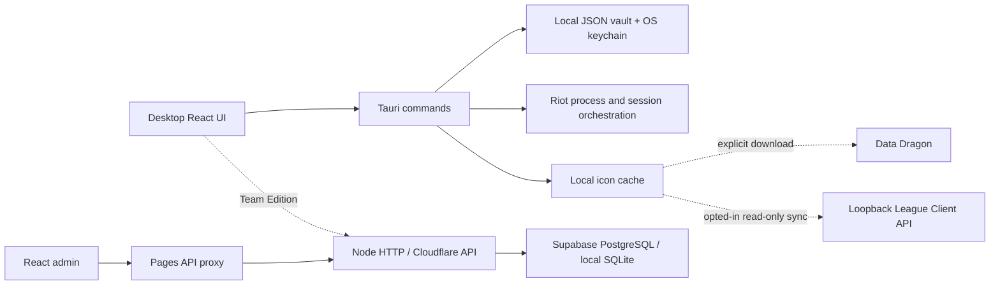

# Architecture

Checked against v0.4.5 source on 2026-10-14.

## Components

Offline Edition disables cloud auth, team views, API requests, and update polling. Its webview CSP blocks network connections. Explicit native icon downloads and opted-in loopback sync remain available; CSP does not block Rust HTTP clients.

## Desktop

`src/features/personal-roster` owns local profiles and Add provisioning. `team-vault` owns shared leases and admin credential syncing. Shared UI contains grid/list views, Edit, icon/rank pickers, and dialog primitives. `RiotOperations` coordinates UI busy state and live-match confirmation. `lib/sorting.ts` implements competitive-tier ordering independently of filter matching.

Tauri handlers are registered in `src-tauri/src/lib.rs`. Slow commands run on blocking workers. Local accounts come from IPC only; missing IPC produces an error rather than test accounts.

### Local persistence

`local_store/storage.rs` uses `laap_local_accounts.json`, not SQLite. Session blobs use AES-256-GCM with account-bound associated data and a random key in the OS keychain. Names, regions, ranks, notes, favorites, timestamps, and image references are JSON metadata; images are files in `profile-assets`. Those metadata/image files are not encrypted by the session envelope.

A process mutex and OS file lock serialize whole vault transactions. Unique temporary files are atomically replaced. Unreadable records are quarantined while valid records load; if every record is unreadable, the original vault remains and loading reports an error.

### Session orchestration

`riot/paths.rs` recognizes `RiotGamesPrivateSettings.yaml` and the legacy `RiotClientPrivateSettings.yaml` in Riot Client's data directory.

1. Review detected import metadata before saving, or begin an owned provisioning session.
2. Provisioning stages a backup of the user's settings and temporarily uses the standard client data directory for official Riot sign-in. This is not an OS-isolated second client instance.
3. Closing/canceling the dialog invalidates pending results, cancels its provisioning ID, restores original settings, and removes staging data.
4. A profile launch acquires native operation locks, checks for a League/Valorant game, stops clients, writes the selected session, launches Riot, and updates `last_used_at` after successful launch.
5. Stop Riot preserves login files. Cleanup/recovery restores a managed backup; an owner marker prevents old cloud cleanup from stopping a newer managed session.

Graceful stopping uses WM_CLOSE on Windows or SIGTERM on Unix. After 2.5 seconds, termination is attempted and verified. Failure prevents session injection and returns an actionable error. Recovery runs at startup and every 30 seconds, paused during active operations/provisioning.

### Customization

`profile_assets.rs` validates and normalizes local uploads, caches Data Dragon icons, and performs optional LCU GET requests. Icon and Solo/Duo rank sync are separate opt-ins checked every 20 seconds while enabled, and only the matching saved PUUID is eligible. See [profile customization](profile-customization.md) for transport and cache rules.

Process presence alone does not prove an authenticated account. Login freshness is a conservative capture-age hint, not server-side token validation.

## Team API and database

The Node HTTP router is reused by `apps/api/worker.ts` through Cloudflare's Node compatibility bridge. Domain interfaces in `services/domain` have SQLite and Supabase implementations. SQLite is the local API adapter; production uses Supabase/PostgreSQL.

Authenticated users acquire leases after account, assignment, and device checks. Administrators bypass assignment requirements. A partial unique index over live session statuses prevents concurrent active leases. Desktop heartbeats report runtime state every 20 seconds; missing heartbeats become stale after 120 seconds subject to reconnect grace. Shared leases do not prevent another independent Riot client outside LAAP from signing into an account.

Device signatures are verified when supplied with a device ID; signed challenges use `timestamp:accountId` and a five-minute timestamp window. The current route also permits unsigned acquisition requests subject to service authorization. Do not describe signatures as mandatory or timestamp freshness as one-time nonce consumption.

The admin UI uses same-origin `/api` requests in production; `apps/admin/public/_worker.js` forwards them to the configured API Worker. Browser auth uses HttpOnly cookies, while trusted Tauri responses can provide bearer tokens for native keychain storage.

See [REST API](API.md), [security](SECURITY_MODEL.md), and [production operations](PRODUCTION.md).
