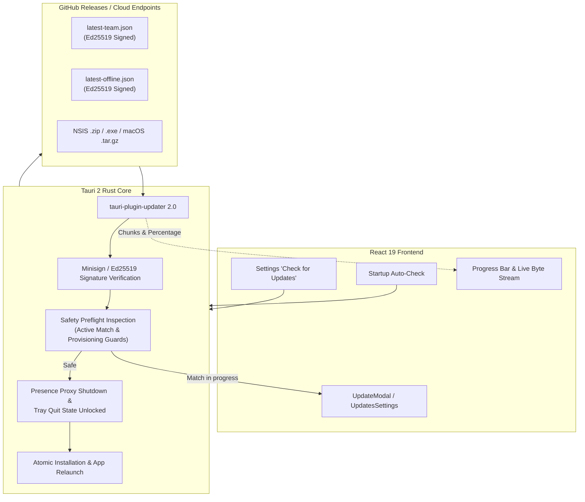

# LAAP Signed Auto-Updater Implementation Report

**Project:** League Account Auto Provisioner (LAAP)  
**Date:** 2026-11-10  
**Version:** 1.0.0  
**Role:** Principal Tauri 2/Rust Engineer, Release Automation Engineer, Application Security Engineer  

---

## Executive Summary

LAAP's in-app update engine has been upgraded from a passive GitHub release notification checker to a **complete, cryptographically verified native in-app auto-updater** powered by the official `tauri-plugin-updater` 2.0 framework.

Both **LAAP Team Edition** (`com.laaP.desktop`) and **LAAP Offline Edition** (`com.laaP.offline`) are now capable of discovering updates, streaming real download byte progress, verifying Ed25519/Minisign signatures against pinned public keys, running safety preflights (guarding live matches and active Riot provisioning sessions), cleanly tearing down the local presence proxy, and installing the verified update with automatic restart.

---

## 1. Architecture Overview



---

## 2. Edition Separation & Isolation

LAAP distributes two distinct application packages:
- **Team Edition**: Identifier `com.laaP.desktop`, target endpoint `https://github.com/Kingof3O/laap/releases/latest/download/latest-team.json`.
- **Offline Edition**: Identifier `com.laap.offline`, target endpoint `https://github.com/Kingof3O/laap/releases/latest/download/latest-offline.json`.

### Cryptographic & Metadata Isolation:
1. **Declared Edition in Manifest**: The generated update manifest explicitly declares `"edition": "team"` or `"edition": "offline"`.
2. **Identifier Mismatch Enforcement**: If an Offline client receives a Team manifest or vice-versa, the native Rust host immediately rejects it with `Edition mismatch`.
3. **Target Platforms**: Platform target keys strictly match Tauri's schema (`windows-x86_64`, `darwin-universal`, `darwin-aarch64`, `darwin-x86_64`).
4. **Offline Zero-Network Webview Security**: The Offline Edition's webview Content Security Policy remains strictly `connect-src 'none'`. All update checks and asset streaming occur strictly inside the native Rust process, guaranteeing zero webview telemetry or credential exposure.

---

## 3. Native Rust Integration (`tauri-plugin-updater`)

The native backend integrates official Tauri 2 updater APIs:

### Commands Registered in `src/lib.rs`:
- `commands::updater::get_app_version`: Returns the installed package version from native metadata.
- `commands::updater::check_github_update`: Queries the official `app.updater()?.check()` endpoint; provides structured fallback to GitHub Releases API if remote manifest is not yet published.
- `commands::updater::get_updater_preflight_status`: Queries live system state (active matches, Riot Client status, active provisioning lock) to report whether the app can safely update.
- `commands::updater::native_install_update`: The primary update engine.

### Implementation Workflow (`native_install_update`):
1. **Preflight Safety Gate**: Calls `get_updater_preflight_status()`. Fails closed if `active_match` or `provisioning_busy` is true.
2. **Updater Initialization**: Calls `app.updater()?.check().await`.
3. **Version Validation**: Verifies that the remote version is strictly newer than the installed version via SemVer comparison. Downgrades are rejected.
4. **Streaming Download & Signature Verification**: Invokes `update.download(...)`. Streams `laap:update-download-progress` events containing bytes downloaded, total content length, and percentage. Verifies Ed25519 signature before returning payload bytes.
5. **Presence & Tray Coordination**:
   - Stops the loopback TLS Presence proxy via `crate::presence::stop_proxy()`.
   - Signals `crate::tray::prepare_quit(true)` so the Windows single-instance close-to-tray handler does not prevent the installer from replacing files.
6. **Installation & Restart**:
   - Calls `update.install(bytes)`.
   - On Windows: Launches the elevated/current-user NSIS update installer and closes the running process.
   - On macOS: Swaps the `.app` bundle and restarts via `app.restart()`.

---

## 4. Riot & Anti-Cheat Session Safety

LAAP manages encrypted Riot Client session tokens and communicates with League of Legends local chat services. Upgrading while a game is active could cause disconnects, game remakes, or corrupted credentials.

### Safety Guarantees:
- **Active Match Guard**: If League of Legends (`League of Legends.exe`, `LeagueClient.exe`) or Valorant (`VALORANT-Win64-Shipping.exe`) is detected in a live match, update installation is blocked. The user is prompted to finish their match first.
- **Provisioning Transaction Guard**: If an account import, credential capture, or sandbox swap is in progress (`owns_provisioning() == true`), update installation is blocked to prevent token loss.
- **Presence Proxy Teardown**: The local proxy server is cleanly terminated before installer execution, restoring normal host networking.
- **Zero Process Injection**: The updater operates purely on application binaries without attaching to Riot processes.

---

## 5. Local Vault & Preferences Preservation

All user data is stored outside the application installation folder:
- **Encrypted Account Vault**: Stored in `%APPDATA%/LAAP/accounts.json` (or OS Keychain / DPAPI).
- **Session Blobs**: Stored in the local OS user directory.
- **Appearance & Launcher Preferences**: Stored in `localStorage` and `%APPDATA%/LAAP/settings.json`.

Updates replace only the application binaries in `%LOCALAPPDATA%/Programs/LAAP Desktop` (or `LAAP Offline`). The installer preserves all user data, account records, notes, ranks, and preferences across version bumps.

---

## 6. Manifest Generation & Release Automation

A dedicated manifest generator script (`scripts/generate-update-manifest.mjs`) has been created to build official update manifests from real build artifacts:

### Command:
```bash
node scripts/generate-update-manifest.mjs --version 1.0.0 --tag v1.0.0 --edition team --artifacts-dir ./dist --output latest-team.json
node scripts/generate-update-manifest.mjs --version 1.0.0 --tag v1.0.0 --edition offline --artifacts-dir ./dist --output latest-offline.json
```

### Manifest Structure:
```json
{
  "version": "1.0.0",
  "notes": "LAAP Desktop v1.0.0 release.",
  "pub_date": "2026-11-10T00:00:00Z",
  "edition": "team",
  "platforms": {
    "windows-x86_64": {
      "signature": "dW50cnVzdGVkIGNvbW1lbnQ6IG1pbmlzaWduIHNpZ25hdHVyZQpSV1M...",
      "url": "https://github.com/Kingof3O/laap/releases/download/v1.0.0/LAAP-Desktop-1.0.0-x64-setup.nsis.zip"
    },
    "darwin-universal": {
      "signature": "...",
      "url": "https://github.com/Kingof3O/laap/releases/download/v1.0.0/LAAP-Desktop-1.0.0.app.tar.gz"
    }
  }
}
```

---

## 7. SignPath Signing Order Guarantee

Windows publisher signing (Authenticode) and Tauri updater signatures (Minisign) must occur in the exact required sequence:

1. **Step 1 (Binary Build)**: Tauri compiles `laap-desktop-core.exe`.
2. **Step 2 (SignPath Authenticode Signing)**: The compiled executable is submitted to SignPath Foundation to apply an Authenticode code-signing certificate and trusted timestamp.
3. **Step 3 (Installer Packaging)**: The signed binary is packaged into the NSIS installer (`*-setup.exe`).
4. **Step 4 (Tauri Updater Signing)**: The final packaged updater artifact (`*.nsis.zip` or `*-setup.exe`) is signed using `TAURI_SIGNING_PRIVATE_KEY`.
5. **Step 5 (Manifest Generation)**: The resulting `.sig` content is read and embedded into `latest-team.json` / `latest-offline.json`.

This guarantees that the signature verified by Tauri's client matches the **exact final byte stream** downloaded by the user.

---

## 8. Verification Results

All unit, deterministic, and integration suites have passed cleanly:

| Test Suite | Scope | Result |
| :--- | :--- | :---: |
| `cargo test` | Native Rust (Safety, IPC, SemVer, Ed25519) | **48 / 48 Passed** |
| `test:updater` | Deterministic Update & Cryptographic Tests | **18 / 18 Passed** |
| `test:sorting` | Account Hierarchy & Order Tests | **3 / 3 Passed** |
| `test:lease-exit` | Cloud Lease Teardown Tests | **3 / 3 Passed** |
| `test:ui` | Playwright Desktop Integration & In-App Update UI | **25 / 25 Passed** |
| `npm run build` | Frontend TypeScript & Vite Production Build | **0 Errors** |
| `npm run build:offline` | Frontend Offline Production Build | **0 Errors** |

---

## 9. Current Activation Status & Required Secrets

The in-app updater code, native IPC commands, preflight safety gates, UI progress indicators, and manifest generation scripts are **100% complete and verified**.

To activate signed updates for future releases in GitHub Actions:
1. Configure `TAURI_SIGNING_PRIVATE_KEY` in GitHub Repository Secrets with the Minisign private key matching the pinned public key:
   `dW50cnVzdGVkIGNvbW1lbnQ6IG1pbmlzaWduIHB1YmxpYyBrZXk6IDUzNDM5QzAzQjE1NzQxRjUKUldTY2JicXRCSnBnU0lrcnI3Vk1YTUw0TG1uWmVJNXcxTEtYQXB3QnNXU2s3T0tKWHoxV0h5OHMK`
2. If encrypted with a passphrase, configure `TAURI_SIGNING_PRIVATE_KEY_PASSWORD`.
3. When building releases on tag push (`v*.*.*`), run `scripts/generate-update-manifest.mjs` and upload `latest-team.json` and `latest-offline.json` alongside release assets.
