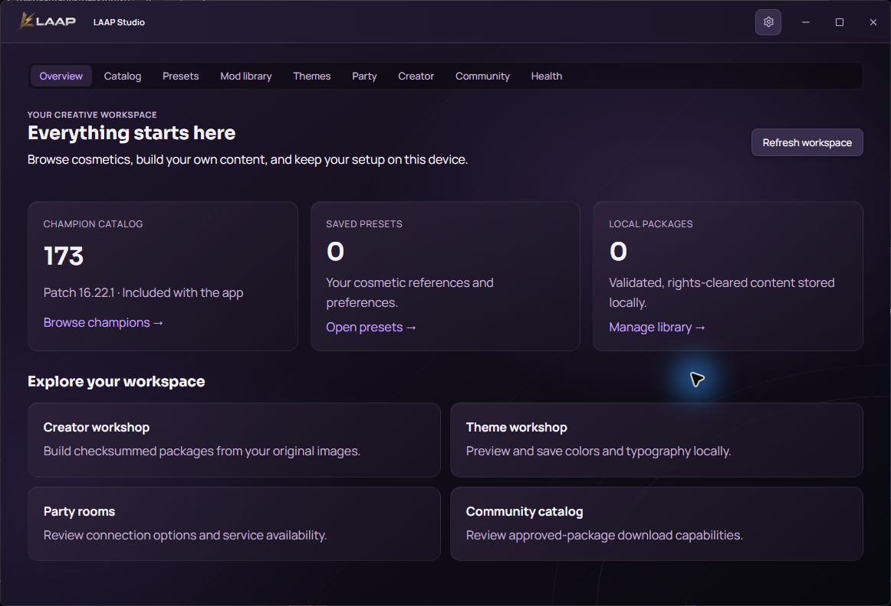
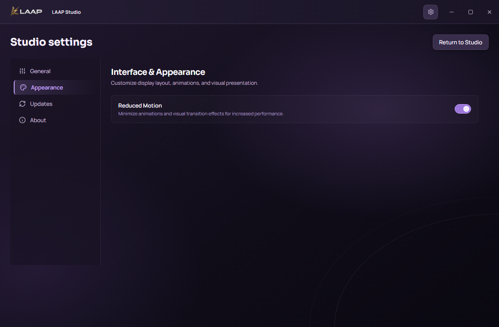

# LAAP Basic, Studio, and Complete implementation

The three edition boundaries are implemented. The remaining parity and release work is open. The starting revision was the fast-forwarded `origin/main` at `6d4475b`; this change has no release tag or deployment.

| Edition | Implemented | Native identity and channel |
| --- | --- | --- |
| Basic | Existing local roster, provisioning, launch, safe switch, profile customization, Presence, tray and settings. Existing updater with retired Team routes and no Studio module registration. | `com.laap.offline`, `latest-offline.json` |
| Studio | Standalone versioned Data Dragon metadata and previews, favorite/history/random catalog preferences, local presets, validated image package library, original image package export, theme preview, tray, party relay and approved catalog clients. Native vault, session switching and Presence modules are excluded. | `com.laap.studio`, `latest-studio.json`. Automatic installation is disabled pending verified signed native upgrade testing. |
| Complete | Basic and the shared Studio workspace. Presets can reference opaque local profile IDs, including a profile inspector entry. Community payloads have no account identity, session, vault or keychain field. | `com.laaP.desktop`, transitional `latest-team.json` |

## Phase evidence

| Phase | Evidence | Status |
| --- | --- | --- |
| P0 | Verified the v2.0 corrections, fetched current main, established the previous tests and signing identities. Reviewed Riot's published Data Dragon, registration and monetization policy. | Repository baseline and policy constraints recorded. External approval not granted here. |
| P1 | Active React entrypoints no longer import Team. Native auth, device and remote injection handlers are no longer registered. Studio omits native local store, launcher and Presence modules. Archive sources and backend are retained. | Client cutover implemented. Authorized Team metadata export, retention/restore rehearsal and installed migrations unverified. |
| P2 | Native Data Dragon fetch plus bounded patch/locale snapshots, offline cached metadata, filters, previews, favorites, recent selections, random champion and saved presets. | Catalog and basic presets work. Full chromas/forms/TFT and queue/preset priority and import/export remain. Preview media needs network unless the webview has cached it. |
| P3 | Bounded native image ZIP validation, strict detached manifests, per-entry hashes, rights declarations, duplicate/unsafe path rejection, file inspection, immutable content by hash and bounded library index. | Image packages work. Full Fantome/WAD/toolchain support, staging and conflict graphs remain. |
| P4 | Theme preview with three validated color surfaces, bundled typeface and local save/reset. | Local preview works. Client apply, theme packs/media, in-client companion and gameflow observer remain. |
| P5 | Original PNG/JPEG/WebP export to a deterministic ZIP and detached manifest, native round-trip and tamper test. | Original image export works at the native command layer. WebView save dialog, project history, conversion/repair, models, textures and other format gates remain. |
| P6 | Separately hosted or loopback WebSocket service with consent, bounded ephemeral room state, sequenced snapshots, reconnect, invite rotation, host transfer and optional cosmetic ID sharing. | Loopback server and browser flows verified. Hosted TLS/operations, Discord, reconnect-storm stress and content transfer remain. Consented chat and a seven-client test were added in the continuation. |
| P7 | Operator-approved on-disk catalog, read-only HTTP transport, download checksum, consent and native revalidation. | Loopback HTTP verified. Hosted service, creator submissions/accounts, reviews, automated moderation/takedown and provider integrations remain. |
| P8 | Three Windows package configurations. Manifest tooling rejects cross-edition filenames and requires a separate Studio key for artifact validation. | Unsigned Windows debug packages built. Commercial licensing, signing and provider/merchant approval remain. |
| P9 | Rust, TypeScript, Playwright, bundle checks, real loopback service tests and unsigned NSIS packaging. | Native installed upgrades, clean Windows/macOS verification, performance measurements and release authorization remain. |

The [25-row product matrix](LAAP_THREE_EDITION_FEATURE_EVIDENCE.csv) and [131-row source parity matrix](LAAP_THREE_EDITION_PARITY_EVIDENCE.csv) record tested, partial, excluded and unfinished items individually.

## Migration, data, and rollback

- The existing `laap_local_accounts.json` format, shared Basic/Complete local storage path and OS credential lookup are unchanged. There is no new vault migration or key rotation. Existing Rust vault, encryption and recovery tests used fixtures, not a user's installed vault.
- Complete keeps the former Team identifier, product/bundle name and updater route. Basic keeps its legacy installer name and Offline identifier. In-app labels use Basic and Complete. Keeping the previous installer names preserves the historical artifact markers and avoids guessing about NSIS install paths. An actual signed upgrade and uninstall/rollback rehearsal is still required.
- Existing Riot accounts owned by the user can be added through the current local provisioning flow. Team assignments and sessions are not automatically imported. The legacy API, admin, stored backups and server-side lease records are untouched. Authorized metadata export and server decommission are separate work.
- Studio and Complete each use their own app-local customization directory under `customization/v1`. Complete's preset binding has only a local profile ID. Deleting a profile does not delete its presets. An unavailable link can be cleared in the editor.
- Default production builds have no Community API URL. The [community service instructions](../apps/community-api/README.md) describe setting up a reviewed endpoint and CSP. No account-sharing backend is reused for the new service.

## Code and verification

The main changed areas are the [native edition gate](../apps/desktop/src-tauri/src/product.rs), [Tauri command registration](../apps/desktop/src-tauri/src/lib.rs), [customization engine](../apps/desktop/src-tauri/src/customization), [shared Studio UI](../apps/desktop/src/features/customization), [local launcher shell](../apps/desktop/src/App.tsx), [community service](../apps/community-api), [bundle isolation check](../scripts/check-edition-isolation.mjs) and [updater manifest tooling](../scripts/generate-update-manifest.mjs). The Git working diff and the two matrices give file-level and requirement-level detail.

| Check | Result |
| --- | --- |
| TypeScript and Vite | All three frontend bundles built; API/admin and Community API type checks passed. |
| Bundle isolation | Verified product IDs and update URLs, plus presence/absence of command names in compiled JavaScript. No retired Team network code in any bundle. |
| Playwright | Basic 25 passed. Studio 2 passed. Complete 2 passed. The product suite includes real loopback party connections. Native IPC is stubbed in the visual/route test. |
| Native Rust | Basic 52 passed, 3 ignored. Studio 17 passed, 2 ignored. Complete 58 passed, 5 ignored in the continuation suite. The existing live profile asset check and the new live catalog contract passed separately against Riot Data Dragon. |
| Updater and legacy code | 38 updater tests, including signed test artifacts with a Windows upgrade simulation. Three sorting tests and three archived lease tests passed. API 15 tests passed. Admin TypeScript test passed. |
| Community | Two integration tests passed against live loopback servers. They cover real WebSocket reconnect and host transfer, and HTTP catalog filtering and tamper handling. |
| Windows NSIS | All three x64 unsigned debug installers built. No installer was run over an existing installation. The attempted instrumented WebView2 launch was blocked by tool policy. |
| Browser visuals | Studio and Complete catalog, library and theme workshop screenshots are under `.artifacts/three-editions-final/visual`. Theme views were captured at 960×640, 1160×760 and 1440×900. |

The local QA installers and SHA-256 values are under `.artifacts/three-editions-final`. They are test artifacts with version 1.0.0, not signed upgrade candidates.

## Release blockers

Studio uses the existing pinned LAAP release public key on its own feed. It needs signed edition-specific artifacts and actual native update/install verification before automatic installation is enabled. Basic and Complete need signed old-to-new installer tests without changing their existing keys or vaults. The Community API needs an approved host, TLS and operating controls. Creator distribution, Riot client adapters, Discord, stats/AI/TTS and paid entitlements need their corresponding rights, approvals, provider credentials or merchant setup and real integration tests. Other rows marked unfinished in the evidence matrices still require engineering. Official paid-skin unlocking, process injection/suspension and protection bypasses are excluded.

Riot's policies require product registration and audit, and an Approved or Acknowledged product for monetization. Data Dragon is a documented static metadata source. See [Riot League of Legends documentation](https://developer.riotgames.com/docs/lol) and [Riot general policies](https://developer.riotgames.com/policies/general).

## Continuation on November 11

The first-launch Studio/Complete pack now includes all 173 champions, 9,268 cosmetic metadata records and 2,136 available public previews from Data Dragon patch 16.22.1. Its compressed resource packs total approximately 106 MiB. Missing provider images have an explicit unavailable state. Data is sourced from Riot rather than generated fixture records. Versioned local caches and background catalog refresh support current data while the bundled snapshot supports first launch without network access. Each champion pack and the catalog index are SHA-256 checked before use.

The workspace opens on an overview with real counts from native catalog, preset and package stores. Further additions include transactional portable preset import with preview, export via native save dialog, duplication, queue preferences, notes, favorites, priority resolution and edit revision checks. Creator exports use native save dialogs and revalidate their package before saving. Health diagnostics and downloaded-preview cleanup cover only the customization store. A consented read-only League phase command reuses the existing local-client connection logic; it exposes no credentials or generic API proxy.

Party rooms now support separately consented ephemeral chat and host member removal. A seven-client integration test passes. The Community API adds durable, independent SQLite issue reports and authenticated immediate package takedown. Public upload, creator login/reviews and production service operation are still open.

A native Studio build was launched through the computer-use skill and its first-launch overview was inspected and saved at `.artifacts/three-editions-native/studio-overview.png`. It displayed the actual included 173-champion catalog. UI automation inputs did not visibly change the native window, so interactive native journeys remain unverified. The earlier instrumented launch rejection is distinct from this successful normal launch.

Installer builds use an isolated Cargo output directory under `.artifacts/cargo-editions-current` while the native test app is open. Current QA installers are collected under `.artifacts/three-editions-current`. These are unsigned debug builds. Prepared workflow edits add Studio on Windows and macOS and require its verified manifest. These workflow edits remain local because the available GitHub OAuth credential lacks workflow scope. The existing SignPath artifact configuration still needs Studio approval and corresponding artifact definitions before a three-product SignPath release can pass all gates.

Native save-dialog commands follow the supported [Tauri dialog plugin](https://v2.tauri.app/plugin/dialog/). Public catalog and artwork sources follow the [Data Dragon documentation](https://developer.riotgames.com/docs/lol#data-dragon).

The continuation verification passed 25 Basic Playwright checks, both Studio browser workflows including settings and both Complete browser workflows, four live Community API integration tests, 38 updater tests and the three-bundle isolation check. The Rust continuation suites passed 17 Studio, 52 Basic and 58 Complete tests, with optional network/native checks reported separately. The generated catalog's offline integration check validated every champion metadata record and portrait. The SQLite moderation test also verifies takedown state survives reopening the database.

The final Studio settings review found a viewport-scrolling issue and corrected the Studio/Complete workspace scroll container so native window controls remain visible. A browser regression assertion checks the titlebar stays within the viewport. Bundle data remains on disk and preview images load on demand.

New third-party dependencies used for native exports are `tauri-plugin-dialog` (Apache-2.0 OR MIT) and its `rfd` dependency (MIT). The production release trust key is reused for Studio's distinct signed channel; a new signing key is not required or generated by this change. Automatic Studio installation remains guarded until actual signed native upgrade verification.

## Reviewed interface captures

The native overview shows actual bundled data. The settings capture below comes from the browser UI verification suite.

## GitHub publication

Application source, verification documents and reviewed screenshots were prepared for a normal branch push. The OAuth credential can push repository content but cannot modify GitHub Actions workflows. The full original implementation commit, including the three workflow changes, is preserved locally at branch codex/three-editions-workflows-local. Workflow edits also remain in the working tree for an authorized workflow-capable push.
