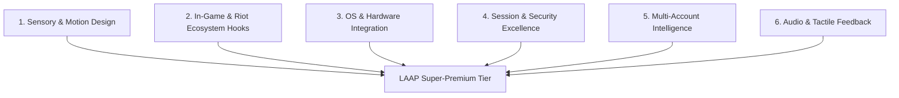

# LAAP Super-Premium Masterplan: Architecture, UX & Roadmap

> **Target Application**: LAAP Desktop Core (Tauri v2 + Vite + React 19 + TypeScript + Rust)  
> **Scope**: Visual & Sensory Polish, Core QoL, Desktop Native Integrations, Riot Ecosystem Hooks, Security & Offline Reliability.

---

## 1. System & Architecture Context (Agent Briefing)

For collaborating AI agents reading this context, LAAP is an offline-first, dual-game (League of Legends & VALORANT) account manager and session orchestrator built on:
- **Frontend**: React 19, TypeScript, Vite, custom obsidian-velvet CSS architecture (`workspace.css`, `cards.css`, `desktop-polish.css`).
- **Native Host**: Rust (Tauri v2), Windows Credential Manager (DPAPI-backed secure storage for Riot session tokens), local named pipe presence proxy, `opgg.rs` headless scraper.
- **IPC Interface**: Tauri commands (`list_local_accounts`, `launch_local_account`, `update_account_riot_id`, `fetch_opgg_summoner_stats`, `runtime_snapshot`, `update_tray`).
- **Core Guarantees**: Zero external telemetry in offline edition, Ed25519-signed in-app updates, safe process termination (match guard blocks mid-match shutdowns).

---

## 2. The 6 Pillars of "Super-Premium"

To feel like an elite desktop application (matching **Linear, Raycast, Discord Nitro, and native Riot Client**), LAAP must excel across six specific dimensions:



---

## Pillar 1: Sensory, Micro-Interactions & Fluid Motion

### 1.1 Physical Spring Slider for Game Selector
- **Current**: Game buttons (`League` vs `VALORANT`) switch instantaneously with CSS class swaps.
- **Premium Target**: A continuous segmented pill with iOS/macOS spring physics (`framer-motion` or CSS spring bezier). As the active game swaps, the pill slides under the target tab with subtle momentum, and cards enter with a staggered vertical cascade (`y: 8px -> 0, opacity: 0 -> 1`).
- **Files**: `PersonalRosterView.tsx`, `desktop-polish.css`.

### 1.2 Windows 11 Native Mica / Acrylic Window Material
- **Current**: Custom dark linear gradients (`#0c0a13`, `#231c31`).
- **Premium Target**: Enable Tauri window backdrop decoration:
  ```rust
  // tauri.conf.json / main.rs
  window.set_decorations(true);
  window.set_effects(Effects::Mica); // Windows 11 Mica backdrop
  ```
- Result: The user's Windows 11 desktop wallpaper faintly diffuses through the titlebar and sidebar at 95% opacity, creating a native OS feel.

### 1.3 Atmospheric Rank Shaders & Ambient Crest Glow
- **Current**: Inspector rank card has a subtle static gradient.
- **Premium Target**:
  - **Challenger / Radiant / Immortal**: Faint animated edge shimmer (subtle conic gradient rotation along border).
  - **Diamond / Emerald / Platinum**: Faint radial gradient behind the crest matching the tier's core color (violet for Diamond, emerald for Emerald, cyan for Platinum).
- **Files**: `workspace.css` (`.inspector-crest`, `.inspector-rank.rank-*`).

### 1.4 Active Account Pulse Halo ("Currently In-Client")
- **Current**: Text says `Client running` on the button.
- **Premium Target**: When the Riot Client or Game process matches a specific profile, the avatar border gains an animated Discord/Steam-style breathing glow ring (`box-shadow: 0 0 0 2px var(--accent-primary), 0 0 12px var(--accent-glow)`).
- **Files**: `AccountCard.tsx`, `cards.css`.

---

## Pillar 2: Core Gaming QoL & Instant Actions

### 2.1 1-Click Riot ID Clipboard Copy with Micro-Toast
- **Current**: Riot ID is static text with a small pencil edit button.
- **Premium Target**: Clicking the Riot ID tag (`Kingof3O#2516`) triggers a native clipboard copy. A micro-pill appears above or next to the tag for 1.6s: `✓ Copied to clipboard!`.
- **Files**: `ProfileInspector.tsx`, `AccountCard.tsx`.

### 2.2 Live Match Deep Spectator Bridge
- **Current**: Inspector shows `In match · Summoner's Rift · 14m` in text.
- **Premium Target**: Make this an interactive button:
  - Hovering previews: `Click to view OP.GG Live Game Spectator`.
  - Clicking opens the OP.GG live game URL directly in the browser, showing all 10 players, their runes, champion masteries, and current ranks.
- **Files**: `ProfileInspector.tsx`, `lib/opgg.ts`.

### 2.3 Win Streaks & LP Velocity Momentum Chips
- **Current**: Shows raw win rate `49% win rate · 136W - 139L`.
- **Premium Target**: Parse recent match streaks from OP.GG match lists:
  - If wins >= 3 consecutive: `🔥 4 Game Win Streak` chip.
  - If recently promoted: `⬆ Promoted to Platinum II` chip.
- **Files**: `ProfileInspector.tsx`, `lib/opgg.ts`.

### 2.4 Faded Champion / Agent Splash Backdrops
- **Current**: Inspector identity card has a plain dark background.
- **Premium Target**: Cache the account's top played champion/agent icon from OP.GG. Render their full-body splash art as an ultra-subtle 10% opacity backdrop behind the rank card or header, masked with a smooth gradient fade into dark obsidian.
- **Files**: `ProfileInspector.tsx`, `workspace.css`.

---

## Pillar 3: Desktop Shell & System Integration

### 3.1 Raycast-Style Global Spotlight Command Palette (`Ctrl+K`)
- **Current**: `Ctrl+K` focuses the inline filter textbox in the toolbar.
- **Premium Target**: Transform `Ctrl+K` into a global floating Command Palette overlay (like Raycast, Linear, or Slack):
  - Type `main` -> selects Main profile, press `Enter` to switch immediately.
  - Type `euw` -> filters all EUW accounts.
  - Type `check live` -> triggers live match API checks for all accounts.
  - Type `stop riot` -> calls Riot process cleanup with confirmation.
- **Files**: New `CommandPalette.tsx`, `App.tsx`.

### 3.2 Rich Windows System Tray 1-Click Quick Switcher
- **Current**: Tray menu has basic text items.
- **Premium Target**:
  - Right-clicking the LAAP tray icon displays pinned favorite accounts with mini rank crests.
  - Clicking an account switches and launches Riot Client without needing to restore the LAAP window.
- **Files**: `apps/desktop/src-tauri/src/tray.rs`.

### 3.3 Windows 11 Taskbar Jump List Integration
- **Current**: Taskbar icon has standard Windows context menu.
- **Premium Target**: Populate the Windows Taskbar Jump List with:
  - `Launch: Main - EUW (Platinum II)`
  - `Launch: Smurf - EUNE (Silver 3)`
  - `Stop Riot Client & Games`
- **Files**: Tauri Windows JumpList API integration.

### 3.4 Global Hotkey Account Switcher (`Ctrl+Alt+L`)
- **Current**: Switching requires alt-tabbing to LAAP.
- **Premium Target**: A registered global Windows hotkey (`Ctrl+Alt+L`) summons a minimal 1-line launcher overlay at the screen center (similar to Alfred or PowerToys Run), letting users swap accounts while on Discord or browsing.

---

## Pillar 4: Advanced Riot Client Orchestration

### 4.1 Custom Launch Arguments & Discord Rich Presence Customization
- **Current**: Launches default Riot Client executable.
- **Premium Target**:
  - Allow per-profile launch flags (e.g. `--locale=ja_JP` to play League in Japanese audio/text, or `--launch-product=league_of_legends`).
  - Customizable Discord Rich Presence status per account: `Playing with Main (Diamond)` vs `Stealth mode (Offline presence)`.
- **Files**: `apps/desktop/src-tauri/src/launcher.rs`.

### 4.2 Companion App Chain-Launching
- **Current**: LAAP only manages the Riot process.
- **Premium Target**: "Launch Companions" toggle in settings:
  - Automatically launch Blitz.gg, Porofessor, Mobalytics, or Outplayed when launching an account, and close them on profile switch.

### 4.3 Daily VALORANT Store Inspection (No Client Launch Needed)
- **Current**: Users must launch the 30GB VALORANT client to see what skins are in their daily store rotation.
- **Premium Target**: Fetch daily rotating store skins via local Riot Client entitlement token and render them in a tab in the inspector.

---

## Pillar 5: Multi-Account Intelligence & Tagging

### 5.1 Account Folder / Category Organization
- **Current**: Flat roster list with Star filter.
- **Premium Target**: User-defined tags & folders:
  - `Main Accounts`, `Smurfs / Secondary`, `Flex 5v5 / Clash Team`, `Unranked Hand-Leveled`.
  - Filter chips or sidebar categories to keep rosters of 10+ accounts effortlessly organized.

### 5.2 Combined Roster Total Asset & XP Tracker
- **Current**: Each account is viewed in isolation.
- **Premium Target**: A collapsible top summary bar or dashboard widget:
  - Total Profiles: `4 League / 2 VALORANT`
  - Highest Peak Rank: `Platinum II 17 LP`
  - Total Level Sum or Active Win Rate across all accounts.

---

## Pillar 6: Security, Vault & Audio Polish

### 6.1 Session Health & Credential Freshness Tooltip
- **Current**: Static `✓ Login saved` pill.
- **Premium Target**: Interactive hover card:
  - `Encrypted via Windows DPAPI Credential Manager`
  - `Last verified: 2 hours ago`
  - `Status: Healthy · Token valid`
  - Reassures privacy-conscious gamers that their credentials are safe and locally contained.

### 6.2 Subtle Hextech Audio Design (With Global Mute)
- **Current**: Silent clicks.
- **Premium Target**: Crisp, high-end micro-sound effects (using Web Audio API or bundled lossless `.wav`):
  - Subtle damped click on card selection (wood/ceramic mechanical feel).
  - Hextech charge chime on "Switch account".
  - Toggle in Settings: `UI Sound Effects: On / Off` (defaults to subtle or off).

### 6.3 Encrypted Vault Backup & Restore
- **Current**: Roster is stored locally in SQLite/AppData and Windows Credential Manager.
- **Premium Target**:
  - `Export Encrypted Backup`: Exports accounts into a `.laapbackup` file encrypted with AES-256-GCM using a user-chosen master password.
  - Allows 1-click restore when formatting PC or setting up a new gaming laptop.

---

## 3. Recommended Implementation Roadmap

| Phase | Milestone | Work Packages | Impact |
| :--- | :--- | :--- | :--- |
| **Phase 1: Sensory Quick Wins** | 1-2 Days | • 1-Click Riot ID Copy with micro-toast<br>• Sliding spring game switcher<br>• Session health tooltip on `Login saved`<br>• Avatar breathing pulse ring when client is running | Immediate tactile premium feel |
| **Phase 2: Live Game & Stats Immersion** | 2-3 Days | • Clickable OP.GG Live Game Spectator bridge<br>• Faded champion/agent backdrop in inspector<br>• Win streak / momentum chips | Deepens gaming companion value |
| **Phase 3: System & Keyboard Power** | 3-4 Days | • Raycast-style `Ctrl+K` Spotlight palette<br>• Rich Windows Tray quick-switch menu<br>• Windows 11 Mica material integration | Establishes LAAP as a tier-1 desktop utility |
| **Phase 4: Advanced Riot Ecosystem** | 1 Week | • Custom client launch args (locale/audio)<br>• VALORANT daily store inspector<br>• Encrypted `.laapbackup` vault export/import | Unmatched competitive advantage |
