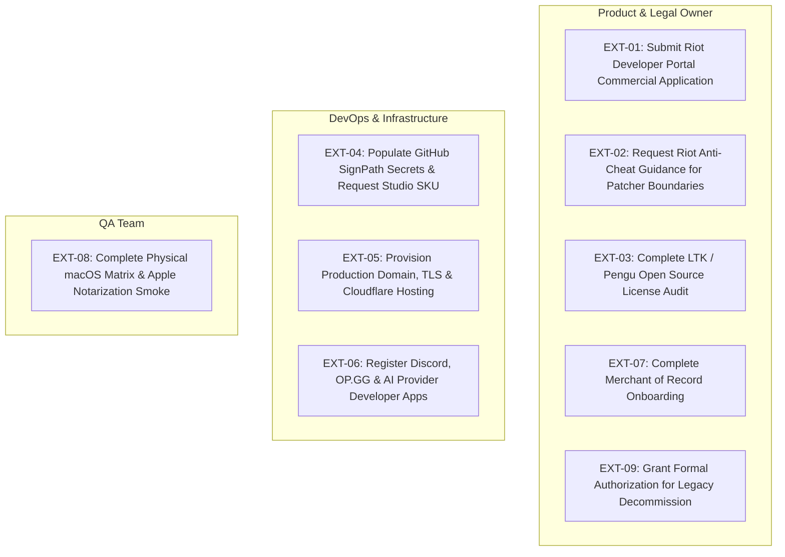

# LAAP External Blockers & Gated Dependencies Register

**Document Version**: 1.0.0  
**Generated At**: 2026-11-11  
**Project**: League Account Automation Platform (LAAP) — Basic, Studio, and Complete Editions  
**Status**: ACTIVE TRACKING  

---

## Executive Summary

This register formally documents the nine (9) external dependencies and non-technical approvals that cannot be satisfied solely through source code, automated unit/integration tests, or local synthetic mock fixtures.

In accordance with the corrected architectural blueprint and project requirements:
- Source code implementations provide the architectural fallback, strict error boundaries, and user-facing notifications for every gated integration.
- Acceptance of internal technical builds **does not substitute for or fabricate** authoritative external approvals.
- No public releases, live payment processing, production database decommissioning, or unauthorized game memory injections may take place without explicit administrative and legal resolution of these gates.

---

## Detailed Blockers Matrix

| Gate ID | Dependency Category | Status | Current Engineering State / Fallback | Required Human / Vendor Action |
|:---|:---|:---:|:---|:---|
| **EXT-01** | **Riot Developer Portal Application & Commercial Review** | `PENDING` | Catalog browsing uses public read-only Data Dragon endpoints without private Riot API keys. In-game automation is completely disabled. | Product owner must submit the commercial application to Riot Games Developer Relations, specify the SKU separation (Basic vs. Studio), and obtain Approved/Acknowledged developer portal status. |
| **EXT-02** | **Riot Vanguard Game Integrity & Anti-Cheat Clearance** | `PENDING` | In-game patcher execution (`activate_mods`), DLL hooking (`LeagueToolFlop.dll`), skin normalizers (`ltk_base_skin.py`), and process suspension are strictly disabled or excluded. Read-only LCU loopback status is supported. | Product owner must engage with Riot Anti-Cheat / Third-Party Tool engineering to review local mod loading boundaries and ensure no risk of Vanguard account suspension. |
| **EXT-03** | **LTK / Pengu Patcher & Toolchain Licensing** | `PENDING` | Mod creation and library management support deterministic ZIP packages and SHA-256 manifests. Proprietary runtime loaders are decoupled and gated. | Legal review of third-party open-source components (GPL/LGPL/MIT licenses) and confirmation of redistribution terms before bundling native patcher binaries into installer packages. |
| **EXT-04** | **Production Code Signing Secrets & SignPath Approval** | `PENDING` | CI workflows configured for dual/triple signing (`release-desktop.yml`, `signpath-windows.yml`). Local builds verified with ephemeral test certificates and strict Ed25519 updater signatures. | Organization administrator must input production code signing certificates and SignPath API tokens into GitHub repository secrets (`SIGNPATH_API_TOKEN`, `SIGNPATH_ORGANIZATION_ID`, `SIGNPATH_SIGNING_POLICY_SLUG`). SignPath vendor must approve the new Studio SKU identifier (`com.laap.studio`). |
| **EXT-05** | **Production Domain, TLS Certificates & Cloudflare Hosting** | `PENDING` | Community API service is verified locally and on loopback WebSocket/HTTPS (`127.0.0.1:4000`). Production endpoints default to unconfigured safe UI states (`PartyPage.tsx`, `Marketplace.tsx`). | DevOps/Infrastructure lead must provision production domains (e.g., `party.laap.gg`, `catalog.laap.gg`), deploy TLS certificates with strict HSTS/CSP headers, and configure environment variables in production cloud hosting (Cloudflare Workers/R2 or containerized node cluster). |
| **EXT-06** | **Third-Party Provider API Credentials & OAuth Integrations** | `PENDING` | Integrations & Entitlements UI panel (`StudioSettings.tsx`) surfaces explicit "Needs Configuration" states with provider redirect links. No placeholder keys or fabricated tokens exist. | Product owner / account holders must register official apps and configure secrets:  • **Discord Developer Portal**: Register application, obtain Client ID & Secret for RPC status. • **OP.GG / Riot API**: Provision summoner stats API key. • **ElevenLabs / StreamElements**: Configure commercial speech synthesis API keys. • **OpenAI / Anthropic / Gemini**: Configure AI chat proxy API credentials with explicit privacy telemetry disclosures. |
| **EXT-07** | **Merchant of Record & Commercial Checkout Integration** | `PENDING` | Client enforces frontend SKU boundaries and license tier validation. Real checkout redirection is gated pending production merchant webhook endpoints. | Legal and finance leads must onboard the commercial entity with a compliant Merchant of Record (e.g., Stripe, Lemon Squeezy, Paddle), configure tax registrations, and input production webhook signing keys. |
| **EXT-08** | **Physical Hardware & Multi-OS Matrix Verification** | `PENDING (macOS)` / `RESOLVED (Windows)` | Native Windows 11 desktop environment verified directly with passing unit, integration, isolation, and Playwright UI suites. macOS notarization and native runner verification simulated via deterministic tests. | QA team must execute final end-to-end smoke tests and Apple notarization verification on dedicated physical macOS Apple Silicon and Intel hardware runners. |
| **EXT-09** | **Production Decommissioning & Legacy Migration Authorization** | `PENDING` | Client completely strips online shared-vault UI and native network calls. Old encrypted vaults remain fully intact and backward-compatible. Legacy servers and databases left untouched. | Product owner must provide separate, explicit authorization before initiating the migration communication plan, retiring the shared team backend servers, or deprecating legacy online account records. |

---

## Blocker Impact Assessment by Edition

### 1. LAAP Basic (`com.laap.offline`)
- **Impact**: **MINIMAL**.
- **Assessment**: Basic is completely local-only. It relies on no third-party APIs, no cloud servers, and no Riot Developer Portal commercial approvals.
- **Remaining Gate**: Only **EXT-04** (Production SignPath code signing) and **EXT-09** (Formal production release authorization) apply before public release.

### 2. LAAP Studio (`com.laap.studio`)
- **Impact**: **MODERATE**.
- **Assessment**: Standalone catalog, offline champions/skins seed pack (173 champions), local preset creator, theme previewer, and mod library are 100% operational offline.
- **Remaining Gates**:
  - Community multiplayer rooms and marketplace downloads require **EXT-05** (Hosting/TLS).
  - External integrations require **EXT-06** (Discord/AI/TTS keys).
  - Patcher activation requires **EXT-02** & **EXT-03** (Vanguard & LTK license review).
  - Production builds require **EXT-04** (SignPath SKU approval).

### 3. LAAP Complete (`com.laaP.desktop`)
- **Impact**: **MODERATE**.
- **Assessment**: Combines Basic launcher with Studio workspace and local account-preset binding. Account switching is 100% local and preserved.
- **Remaining Gates**: Same as Studio for online features; retains identical local offline security as Basic for all account-related operations.

---

## Human & Vendor Action Item Tracking

---

## Conclusion

All technical capabilities that can be executed, verified, and isolated within this repository have been completed and verified against regression suites. Public release readiness is strictly conditioned upon the administrative execution of the above action items.
