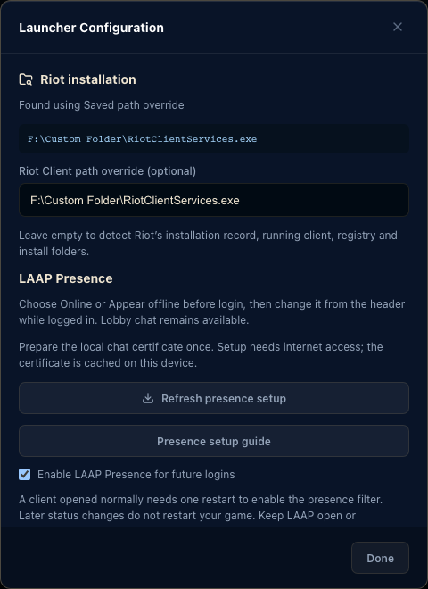

# Riot installation discovery and LAAP Presence

Implemented in source after v0.4.5; not included in the published v0.4.5 installers.



## Riot installations on other drives

Windows launch now discovers an existing `RiotClientServices.exe` from:

1. A saved, validated path override in Launcher Configuration.
2. `%PROGRAMDATA%/Riot Games/RiotClientInstalls.json`, including current/default/beta entries and associated clients.
3. The executable path of an already running Riot Client.
4. HKCU/HKLM Riot, App Paths, and uninstall registry entries in both 32-bit and 64-bit views.
5. Standard install folders and known Riot folders on mounted fixed/removable drives.

There is no recursive whole-drive scan. Missing or stale candidates are skipped. Quoted registry commands, environment variables, custom folder names and spaces are handled. The executable is launched directly, without passing a path through a shell. A launch plan resolves the path before clients are stopped or session files are changed, so missing installations do not interrupt a working client.

Open **Settings → Riot installation** to inspect the detected path/source, paste an override, or run **Detect again**. Overrides must point to an existing `RiotClientServices.exe` or its containing Riot Client folder. Leave the override empty for automatic detection.

## LAAP Presence

The product feature is named **LAAP Presence**. It is implemented inside the native Rust app. It does not install or launch a separate executable, inject code, create a fake friend, or automate gameplay.

Presence controls are available on Windows. The current source project's PKCS#12 certificate cannot be imported through macOS's native TLS API in local validation, so the Mac UI does not offer an unverified presence option. Normal macOS launch remains available.

To enable:

1. Open **Settings → LAAP Presence** and choose **Prepare presence controls**.
2. Save **Enable LAAP Presence for future logins**.
3. Choose **Online** or **Appear offline** from the header before launching an account.

A client started normally needs an explicit restart through LAAP once to enable the proxy. The restart follows the same live-match confirmation guard as Stop/Switch. Once the session is routed, the header changes presence live by replaying the latest global presence stanza; it does not restart the client or game.

The UI distinguishes saved startup mode, waiting for routing/chat, an active filter, and errors. It reports the local filter state, not an independently verified friends-list result. Unknown or failed states never claim that offline presence is active.

Keep LAAP open or minimized while a proxied client is running. Normal close/quit requests are prevented while the active chat proxy is needed, with an explanation in the presence banner. **Stop Riot** closes the clients and the proxy. Use **Online** for normal visibility during the session; stop Riot before disabling the feature for future launches.

## Troubleshooting setup

If detection cannot find Riot, open the official client once to refresh its record or paste the full executable path in Settings. If certificate setup fails, retry **Refresh presence setup**; a corrupt, expired or untrusted identity is rejected before launch.

The chat compatibility hostname must resolve to `127.0.0.1`. Some DNS services block names that resolve to loopback. You can inspect it on Windows with `Resolve-DnsName deceive-localhost.molenzwiebel.xyz -Type A`. Use a network-approved DNS configuration or a manually reviewed hosts entry if necessary. LAAP does not change system DNS or edit the hosts file.

## Transport and privacy

- Presence is disabled by default. The Offline Edition's local vault mode is separate from online/offline game presence.
- Setup explicitly fetches and caches the reference project's public loopback TLS identity. The hostname is `deceive-localhost.molenzwiebel.xyz`; it must resolve only to `127.0.0.1`. This technical compatibility hostname does not change the LAAP feature name.
- Certificate downloads use HTTPS. A failed system-DNS route can retry using a fixed Google DNS-over-HTTPS query for the certificate provider's hostname. No user/account data is included. The download's normal TLS hostname verification remains enabled.
- Before launch, LAAP verifies the cached certificate chain, hostname and validity through a local TLS handshake. It does not install a root certificate or disable TLS validation. **Refresh presence setup** obtains a renewed identity when needed.
- Configuration and chat listeners bind only to IPv4 loopback on dynamically allocated ports. Riot is launched with a local `--client-config-url` when presence is enabled.
- The configuration proxy forwards only required headers to Riot's fixed HTTPS configuration/affinity services. Redirects are disabled, upstream chat endpoints must be recognized Riot domains, and upstream TLS certificates are verified normally.
- The chat relay frames fragmented XML before changing global presence. Offline mode clears the game/activity payload and sets the global show state to offline. Online mode replays the original presence. Directed presence and chat messages, including lobby traffic, pass through unchanged.
- Authentication tokens and chat contents remain in memory, are not logged or persisted, and are not sent to LAAP's cloud API or the certificate/DNS services. The cached TLS identity is a public compatibility asset, not a user's Riot session.
- Proxy resources are stopped with the client. Setup, routing, certificate and connection failures remain visible and can be retried. Riot protocol changes can require an implementation update; no Riot-approval or ban guarantee is made.

## Verification

Native tests cover custom install records, stale paths, quoted registry strings, atomic preference writes, fragmented XML, directed chat, unknown activity removal, TLS/routing rejection, and changing presence on a live in-memory stream without restart. Browser tests cover custom-path settings, explicit setup/opt-in, waiting/active states and guarded activation restart.

The Windows-only public certificate contract is opt-in:

```sh
cargo test --locked --manifest-path apps/desktop/src-tauri/Cargo.toml presence_public_certificate_contract -- --ignored
```

It downloads the current public identity, performs a real local TLS validation handshake and starts/stops the listeners. It never reads a Riot login or modifies a real user profile. The manual **Verify LAAP Presence transport** GitHub workflow runs this contract on Windows.

Live authenticated Riot chat/friends-list behavior still requires a supported Windows installation and real-account testing; fixtures and the local transport test do not establish that result.

## Reference attribution

Protocol research used [molenzwiebel/Deceive](https://github.com/molenzwiebel/Deceive), especially its configuration routing and presence filtering behavior. That project is licensed under GPL-3.0. LAAP uses an independent Rust implementation of the protocol behavior; it does not bundle that project's executable or copy its C# implementation. The public loopback certificate and hostname remain maintained by that project. Its copyright/licensing and availability are separate from LAAP's MIT-licensed code.
